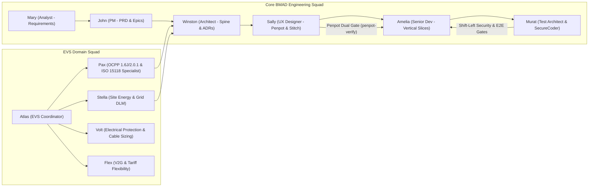

# AI Governance, BMAD v3.1 Multi-Agent Discovery & Context Management

```yaml
title: Mapletyne MTT Charge AI Context Management & BMAD v3.1 Governance Specification
version: "2.0.0"
date: "2026-10-21"
status: approved
author: Murat (Master Test Architect & SecureCoder Lead) & Winston (System Architect)
scope: BMAD v3.1 Multi-Agent Orchestration, Rolling 1,500-Token Context Window, Penpot Dual Gate, Shift-Left Security
components: [ACTIVE_CONTEXT.md, DECISION_RECORDS.md, penpot-mcp, stitch-mcp, securecoder, langfuse]
```

---

## 1. BMAD v3.1 Multi-Agent Discovery & Squad Assembly Protocol

Autonomous and human-in-the-loop engineering on the Mapletyne MTT Charge CPO platform (`opencpo`) is governed by the **BMAD v3.1 Multi-Agent Orchestration Protocol**. Domain specialists collaborate across deterministic vertical slices without polluting shared context windows:



### Multi-Agent Discovery Sequence
Before any agent writes or modifies application code, it executes a deterministic 3-step discovery sequence:
1. **Read `AGENTS.md`:** Enforces repository-wide invariants (strictly Google Material Symbols `material-symbols-outlined`, isolated `feat/STORY-XX` branches, single-responsibility vertical slices).
2. **Read `docs/project/ACTIVE_CONTEXT.md`:** Loads the current sprint state, active story acceptance criteria, and immediate blockers within a bounded token budget.
3. **Read `docs/architecture/DECISION_RECORDS.md`:** Verifies immutable Architectural Decisions (`AD-01` through `AD-12`, including Keycloak IAM `AD-11` and Two-Step Registration `AD-12`).

---

## 2. Rolling 1,500-Token Working Memory Window (`ACTIVE_CONTEXT.md`)

To prevent LLM context degradation ("lost-in-the-middle" phenomenon) and runaway token costs during multi-story autonomous loops:

- **Hard Token Cap ($\le 1,500\text{ Tokens}$):** `docs/project/ACTIVE_CONTEXT.md` is strictly bounded to a **rolling 1,500-token window** containing only:
  1. Active Sprint Goal & Current Story ID (`STORY-XX`).
  2. Live Service Topology & Port Map (`opencpo-core:8000`, `ocpp16:9100`, `ocpp201:9201`, `mtt-admin:8080`, `opencpo-charge-app:8003`, `keycloak:8080`).
  3. Current Story Acceptance Criteria & Open Blockers.
  4. Last 3 Completed Hand-off Checkpoints.
- **Automated Sprint Compaction:** Upon story or sprint completion, verbose execution logs, test outputs, and resolved debugging traces are compacted and archived into `docs/project/history/SPRINT_<ID>_SUMMARY.md` and `docs/architecture/DECISION_RECORDS.md`.
- **Subagent Context Isolation:** Deep codebase reconnaissance (`bmad-deep-recon`, `evs-research`), adversarial code reviews (`bmad-code-review`), and security scans run in isolated subagent conversations, returning only distilled, cited summaries (`< 400 tokens`) to the parent orchestrator.

---

## 3. Penpot Dual Gate UI/UX Verification (`penpot-verify`)

All frontend modifications in `mtt-admin` (Operator Dashboard) and `opencpo-charge-app` (Driver Mobile PWA) must pass the **Penpot Dual Gate Protocol** orchestrated by Sally (`bmad-agent-ux-designer`):

| Gate | Stage | Verification Mechanism | Pass Criteria |
| :--- | :--- | :--- | :--- |
| **Gate 1: Pre-Implementation Design Spec Gate** | Before Frontend Coding (`Phase 2 -> Phase 3`) | Inspect design frames, typography tokens, dark glassmorphic color variables, and component hierarchies via `penpot` / `penpot-live` and `stitch` MCP tools. | Design tokens (`BRAND_PRIMARY_COLOR`, surface elevation, spacing scale) and component states (loading, empty, error, OTP modal) are explicitly mapped to React 19 components. |
| **Gate 2: Post-Implementation Visual & DOM Gate (`penpot-verify`)** | Before Story Sign-Off (`Phase 3 -> Phase 4`) | Automated `penpot-verify` audit compares rendered DOM styles, layout geometry, and iconography against the canonical Penpot specification. | **100% Iconography Compliance:** Only `material-symbols-outlined` used (zero Lucide, Heroicons, or FontAwesome imports). Visual delta within tolerance and responsive breakpoints verified. |

---

## 4. Shift-Left Security Scanning & Automated Verification Pipeline

Murat (`bmad-tea` & `securecoder-persona`) enforces mandatory shift-left security gates across every AI-generated commit before merge:

1. **Pre-Import Dependency Gate (`scan_dependencies`):** Every new Python (`pyproject.toml` / `requirements.txt`) or Node.js (`package.json`) package must be vetted for known CVEs, license compatibility, and typosquatting **before** any `import` statement is written.
2. **Secure Generation Guardrails (`mandatory-secure-web-skills`):** Code generation enforces parameterized SQL queries, PostgreSQL Row-Level Security (RLS) tenant binding, strict OCPP JSON schema validation, and Keycloak RS256 JWT route guards.
3. **Automated Vulnerability & PoC Verification (`run-security-scanner` & `run-poc`):**
   - Modified source files are scanned for CWE vulnerabilities (SQLi, XSS, SSRF, IDOR/BOLA, hardcoded secrets, insecure cryptography).
   - Any remediated finding is verified with an automated Proof-of-Concept (`run-poc`) regression test and documented via `generate-security-audit-report`.
4. **End-to-End Regression Suite:** Every vertical slice must pass `python3 tests/test_e2e_all_apis_buttons_links.py` alongside `helm lint deploy/kubernetes/helm/opencpo` and `docker compose -f deploy/docker-compose.prod.yml config` with zero warnings or errors.

---

## 5. Model Context Protocol (MCP) Server Routing Matrix

| MCP Server | Primary Capabilities | Authorized Agents | Activation Phase |
| :--- | :--- | :--- | :--- |
| **`penpot` & `penpot-live`** | Inspect design systems, export frame PNG/SVG, verify CSS/layout tokens (`penpot-verify`) | Sally (UX), Amelia (Dev), Murat (QA) | Phase 2 (UX Design) & Phase 4 (Dual Gate Verification) |
| **`stitch`** | Rapid UI screen drafting, variant generation, design system synchronization | Sally (UX), Winston (Architect) | Phase 1.1 (Ideation) & Phase 2 (Prototyping) |
| **`filesystem` / Native File Tools** | Deterministic reading/editing of codebase and `docs/**` specifications | All Squad Agents | All Phases (Scoped by role boundaries) |
| **`securecoder` Skills** | Threat modeling, dependency scanning, CWE static analysis, PoC verification | Murat (Test Architect & SecureCoder), Amelia (Dev) | Pre-code planning, Post-code verification & CI Gates |
