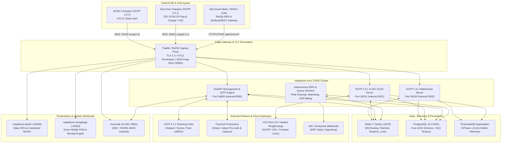

# Mapletyne MTT Charge CPO — System Architecture Specification

**Specification Version:** 3.2.0 (Enterprise Gold Standard)  
**Lead Architects:** Winston (System Architect), Pax (OCPP & V2G Protocol Specialist), Volt (Electrical & Grid Systems Lead)  
**Scope:** End-to-End Topology, Service Boundaries, OCPP 1.6-J / 2.0.1 / ISO 15118-20 Engines, Multi-Tenant Persistence, and Security Trust Boundaries

---

## 1. System Topology & Boundaries

The **Mapletyne MTT Charge CPO Enterprise Platform** is built on an event-driven, multi-tenant, cloud-native architecture designed for mission-critical Charge Point Operators (CPOs), commercial EV fleet depots, and e-Mobility Service Providers (eMSPs). It decouples presentation layers (`mtt-admin`, `mtt-charge-app`) from the high-concurrency CSMS protocol engine (`mapletyne-core`).

### 1.1 Runtime & Service Matrix

| Workload / Service | Runtime Stack | Host Port | Container Port | Primary Responsibilities |
| :--- | :--- | :---: | :---: | :--- |
| **`mapletyne-core` (REST & SSE)** | Python 3.12+ / FastAPI / Uvicorn | `34800` | `8000` | 147+ OpenAPI 3.1 REST endpoints, SSE live streams (`/api/v1/events/stream`), Prometheus `/metrics`, OCPI 2.2.1 peering, EMS load controller |
| **`mapletyne-core` (OCPP 1.6-J)** | Python 3.12+ / `websockets` / `ocpp` | `34100` | `9100` | Bidirectional OCPP 1.6-J JSON-over-WebSocket subprotocol (`ocpp1.6`), Core, Firmware, LocalAuth, SmartCharging, RemoteTrigger profiles |
| **`mapletyne-core` (OCPP 2.0.1 / V2G)** | Python 3.12+ / `websockets` / `ocpp` | `34201` | `9201` | Bidirectional OCPP 2.0.1 & ISO 15118-20 Plug & Charge WebSocket server (`ocpp2.0.1`), Device Model, 15118 Exi/Certificate signing, bidirectional BPT (V2G) |
| **`mapletyne-admin`** | React 19 + Vite + Tailwind CSS v4 (Nginx) | `34000` | `8080` | High-density Operator Mission Control SPA (0px industrial geometry, virtualized tables, 3-phase ECharts oscilloscope, Depot Cockpit) |
| **`mapletyne-chargeapp`** | Python 3.12+ / FastAPI / PWA | `34003` | `8003` | Driver-facing Mobile PWA, QR ad-hoc charging, Stripe/Adyen Apple/Google Pay pre-auth, live SoC curve, VAT PDF receipts |
| **`keycloak`** | Keycloak 26 (Quarkus) | `8081` | `8080` | Unified OIDC/OAuth2 Identity & Access Management (IAM), RS256 JWT issuance, RBAC realm roles, 2FA/SSO federation |
| **`postgres`** | PostgreSQL 16 + TimescaleDB 2.14+ | `5432` | `5432` | ACID relational store (`ocpp` schema) + TimescaleDB hypertables for 3-phase L1/L2/L3 meter telemetry, continuous aggregates |
| **`redis`** | Redis 7.2 Alpine (AOF + LRU) | `6379` | `6379` | Live OCPP WebSocket session routing, charger heartbeat state, Pub/Sub SSE fan-out, Redis Streams (`XADD`), Arq/task queues, distributed locks |

### 1.2 End-to-End Architecture Topology



---

## 2. Electrical & Protocol Engineering Architecture

### 2.1 OCPP 1.6-J & OCPP 2.0.1 Dual-Stack Engine
`mapletyne-core` operates dedicated asynchronous asyncio WebSocket listeners for OCPP 1.6-J (`:34100`) and OCPP 2.0.1 (`:34201`):
- **Connection Lifecycle & Subprotocol Negotiation:** Chargers connect to `wss://ocpp.mapletyne.com/ocpp16/{cp_id}` or `wss://ocpp.mapletyne.com/ocpp201/{cp_id}` advertising `Sec-WebSocket-Protocol: ocpp1.6` or `ocpp2.0.1`. Connections without a valid subprotocol or unauthenticated credentials (HTTP Basic Auth Profile 1/2 or mTLS Client Certificate Profile 3) are rejected during the HTTP 101 handshake.
- **Cross-Worker Command Routing:** When an operator triggers `POST /api/v1/chargers/{cp_id}/start` or the EMS loop dispatches `SetChargingProfile`, the FastAPI worker looks up the owning WebSocket process in Redis (`mtt:{env}:{tenant}:ws:route:{cp_id}`) and publishes an RPC envelope onto `mtt:{env}:{tenant}:ws:cmd:{cp_id}`. The process holding the live TCP socket transmits the CALL frame (`[2, "<messageId>", "<action>", {<payload>}]`) and correlates the CALLRESULT (`[3, "<messageId>", {<payload>}]`) via an `asyncio.Future` with a strict 30-second timeout.
- **ISO 15118-20 Plug & Charge & V2G:** Supports `Authorize`, `Get15118EVCertificate`, `GetCertificateStatus`, and `SignCertificate` messages. Contract certificates (EMAID) are validated cryptographically against the V2G Root CA chain and OCSP/CRL caches in under 150ms. Dynamic and bidirectional power transfer (`BPT_Dynamic` / `ISO15118-20`) schedules discharge/charge setpoints for V2G-capable fleet depots.

### 2.2 Autonomous Energy Management System (EMS) & 3-Phase Load Balancing
The Electrical & Energy Systems engine prevents site transformer overloads and demand-charge spikes:
- **3-Phase Phase-Aware Curtailment:** Tracks per-phase current (`I_L1`, `I_L2`, `I_L3` in Amperes) and phase-to-neutral/phase-to-phase voltages (`V_L1`, `V_L2`, `V_L3` at 230V/400V EU or 277V/480V NA) alongside power factor ($\cos\phi$) and Total Harmonic Distortion (THD).
- **Dynamic Headroom Formula:**
  $$P_{\text{available\_ev\_kw} }(t) = \min\left(P_{\text{grid\_limit\_kw} }, P_{\text{scada\_override\_kw} }(t)\right) \times (1 - \text{SafetyMargin}) - P_{\text{building\_kw} }(t) + P_{\text{solar\_kw} }(t) + P_{\text{bess\_discharge\_kw} }(t)$$
- **Dispatch Loop:** Every 5 seconds (or immediately upon SCADA override via `POST /api/v1/ems/override`), the EMS engine calculates per-bay power allocations weighted by Fleet Departure Target (`target_departure_at`), Current vs. Target SoC (`current_soc_pct` $\rightarrow$ `target_soc_pct`), and tariff priority, dispatching `SetChargingProfile` (`TxProfile` / `ChargingStationMaxProfile`) to active EVSEs.
- **Autonomous Self-Healing Watchdog:** Continuously monitors `StatusNotification` fault codes (`ConnectorLockFailure`, `EVCommunicationError`, `GroundFailure`, `OverCurrentFailure`, `UnderVoltage`). Non-critical lock/comm faults trigger **Tier 1 Recovery** (`UnlockConnector`), escalating to **Tier 2 Recovery** (`Reset(Soft)`) if unresolved within 90 seconds, while safety-critical electrical faults (`GroundFailure`, `OverTemperature`) immediately lock out the EVSE (`ChangeAvailability(Inoperative)`) and page operations.

---

## 3. Multi-Tenant Data Storage & Persistence

- **Isolation Model:** Hybrid Enterprise Tenancy supporting **Model A (Database-per-Tenant Isolation)** following the deterministic 4-segment naming standard `{platform}_{environment}_{tenant_slug}_{domain}` (e.g., `mapletyne_prod_fleetalpha_core`) AND **Row-Level Security (`tenant_id` UUID)** inside shared schemas (`ocpp.*`) enforced via `SET LOCAL app.current_tenant_id = '<uuid>'` on every SQLAlchemy/asyncpg transaction checkout.
- **Primary Relational Store:** PostgreSQL 16 (`ocpp` schema) storing tenants, sites, EVSEs, connectors, charging sessions, immutable fiscal CDRs, TOU tariffs, RFID tokens, fleet vehicle rosters, OCPI 2.2.1 partner credentials, and X.509 PKI certificate ledgers.
- **Time-Series Store:** TimescaleDB hypertable `ocpp.meter_values` partitioned by `time` (7-day chunks) and segmented by `(tenant_id, charge_point_id, connector_id)` with native columnar compression after 14 days and continuous aggregates (`ocpp.meter_values_hourly`, `ocpp.meter_values_daily`).
- **Ephemeral & Streaming Store:** Redis 7 with AOF persistence (`appendonly yes`) and `allkeys-lru` eviction policy for non-locked cache keys, structured under hierarchical colon prefixes `mtt:{env}:{tenant}:{resource}:{id}`.
- **Object Storage:** S3-compatible storage (AWS S3 / Cloudflare R2 / MinIO) + `/app/backups` volume for signed PDF tax invoices, charger diagnostic logs (`GetDiagnostics` / `GetLog`), OTA firmware bundles, and encrypted database snapshots.

---

## 4. Background Processing & Asynchronous Queues

- **Queue Engine:** Redis-backed asynchronous worker pool (`arq` / Redis Streams consumer groups) running inside dedicated worker coroutines/containers.
- **Worker Latency Budget:** Any operation exceeding **200ms** or invoking external network I/O (PDF rendering, SMTP OTP dispatch, Stripe payment capture, OCPI CDR push, webhook delivery, PKI CRL regeneration) is strictly offloaded to background queues.
- **Idempotency Guarantee:** All mutating REST endpoints (`POST`, `PUT`, `PATCH`, `DELETE`) and background tasks enforce UUIDv4 idempotency via `X-Idempotency-Key` locked in Redis (`mtt:{env}:{tenant}:locks:idemp:{key}`, TTL `86400s`).

---

## 5. Security Trust Boundaries & Threat Model

```mermaid
sequenceDiagram
    autonumber
    actor Operator as CPO Operator / Driver
    participant SPA as mtt-admin / ChargeApp
    participant Gateway as NGINX Ingress (:443)
    participant Core as mapletyne-core (:34800)
    participant KC as Keycloak 26 (:8081)
    participant DB as PostgreSQL 16 (RLS)

    Operator->>SPA: Submit Credentials (Username / Password)
    SPA->>Gateway: POST /api/v1/admin/auth/login
    Gateway->>Core: Forward Request
    Core->>KC: POST /realms/opencpo/protocol/openid-connect/token (Direct Grant)
    KC-->>Core: RS256 access_token + refresh_token
    Core-->>SPA: 200 OK (JWT + Role Claims + Tenant Context)
    
    Note over SPA,DB: Authenticated Tenant-Scoped Request
    SPA->>Gateway: GET /api/v1/chargers (Authorization: Bearer <JWT>)
    Gateway->>Core: Forward Request
    Core->>Core: Verify RS256 Signature via Cached JWKS & Extract tenant_id + roles
    Core->>DB: BEGIN; SET LOCAL app.current_tenant_id = '<tenant_id>'; SELECT ...
    DB-->>Core: Tenant-Scoped Charger Rows
    Core-->>SPA: 200 OK (Typed OpenAPI JSON)
```

- **Unified IAM (Keycloak 26):** All human users authenticate against Keycloak 26 (`opencpo` realm). `mapletyne-core` validates RS256 Bearer tokens locally using cached JWKS public keys (`mtt:shared:auth:jwks`, 3600s TTL) and enforces fine-grained RBAC roles (`cpo-admin`, `site-operator`, `billing-manager`, `fleet-manager`, `driver`).
- **Machine-to-Machine (M2M) Authentication:** Internal services and headless SCADA integrations authenticate via scoped `X-API-Key` headers validated with constant-time `secrets.compare_digest`, while OCPI 2.2.1 peers use `Authorization: Token <base64_token_c>`.
- **Hardware mTLS (OCPP Security Profile 3):** Production EVSEs connect over TLS 1.3 with client certificates signed by the Mapletyne SECC Sub-CA. Certificate serials are checked against the live PKI revocation list on handshake.
- **Raw Buffer Webhook Verification:** Inbound webhooks (`/api/v1/public/payments/webhook/stripe`, `/api/v1/public/payments/webhook/adyen`, `/api/v1/ocpi/2.2.1/*`) bypass JSON body parsing to verify raw byte buffers with HMAC-SHA256 signatures and 300-second replay-window checks.
- **Container Hardening (CIS Docker Benchmark v1.6.0):** All containers run as unprivileged non-root UIDs (`10001:10001` for Python services, `101:101` for NGINX, `999:999` for Redis) with `no-new-privileges: true` and `cap_drop: [ALL]`.
