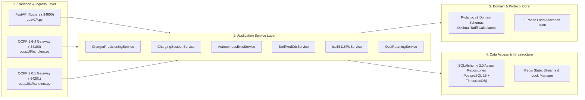

# Backend Engineering Rules, Service Layering & Clean Architecture (`mapletyne-core`)

**Specification Version:** 3.2.0 (Enterprise Gold Standard)  
**Runtime Target:** Python 3.12+ (`asyncio`), FastAPI (`:34800`), OCPP 1.6-J (`:34100`), OCPP 2.0.1 & ISO 15118-20 (`:34201`)  
**Scope:** Clean Architecture Boundaries, Asyncio Concurrency Safety, OCPP State Machines, Financial Precision, and Observability

---

## 1. Clean Layered Architecture Invariants

`mapletyne-core` enforces strict separation of concerns across four vertical layers. Dependencies must point strictly inward (`Transport -> Service -> Domain -> Repository`).



### 1.1 Layer Responsibilities & Hard Prohibitions

| Layer | Module Path | Allowed Responsibilities | Strictly Prohibited |
| :--- | :--- | :--- | :--- |
| **1. Transport (REST & OCPP WS)** | `app/api/v1/`, `app/ocpp16/`, `app/ocpp201/` | Parse HTTP/WebSocket frames, validate Pydantic v2 DTOs, verify JWT / `X-API-Key` / mTLS identity, bind `tenant_id` context, map domain exceptions to HTTP status codes or OCPP `CallError`. | Writing raw SQL or SQLAlchemy queries; executing inline tariff math; calling external HTTP APIs directly. |
| **2. Service Layer** | `app/services/` | Orchestrate business workflows, manage database transaction boundaries (`async with uow:`), acquire Redis distributed locks, emit Redis Stream events (`XADD`), enqueue background jobs. | Importing `fastapi.Request` or `fastapi.Response`; manipulating raw WebSocket sockets directly. |
| **3. Domain Core** | `app/domain/` | Pure, deterministic business logic: TOU tariff segment slicing, 3-phase kW/Ampere conversion, ISO 15118 X.509 chain verification, state transition guards. | Any network, disk, Redis, or database I/O. Domain functions must be 100% unit-testable without mocks. |
| **4. Repository & Infra** | `app/repositories/`, `app/infra/` | Encapsulate SQLAlchemy 2.0 `AsyncSession` queries, TimescaleDB hypertable batch inserts, Redis pipeline operations, and S3/Keycloak/Stripe SDK adapters. | Mutating business state without service orchestration; bypassing `tenant_id` Row-Level Security (RLS). |

---

## 2. Python 3.12+ & Asyncio Concurrency Rules

1. **Zero Event-Loop Blocking:** `mapletyne-core` handles thousands of concurrent OCPP WebSocket connections and SSE streams on a single `uvloop` / `asyncio` event loop per worker.
   - **BANNED:** `time.sleep()`, `requests.*`, synchronous `psycopg2`, synchronous `redis.Redis`, CPU-heavy synchronous X.509 RSA key generation on the main thread.
   - **MANDATORY:** `await asyncio.sleep()`, `httpx.AsyncClient`, `sqlalchemy.ext.asyncio.AsyncSession` (`asyncpg`), `redis.asyncio.Redis`, and `await asyncio.to_thread(...)` for CPU-bound cryptographic operations (`cryptography.x509`).
2. **Strict Type Annotations:** All functions, methods, and coroutines must declare complete Python 3.12 type hints (`mypy --strict` compliance). Use `typing.Annotated` with FastAPI `Depends` and Pydantic `Field`.
3. **Monetary & Electrical Arithmetic:**
   - **Financial Calculations:** Strictly use `decimal.Decimal` initialized from strings (e.g., `Decimal("0.3850")`). Never use `float` for energy cost, time cost, idle fee, tax/VAT, or OCPI settlement totals. Quantize invoice totals using `Decimal("0.01")` with `ROUND_HALF_UP`.
   - **Electrical Calculations:** Three-phase active power conversion to per-phase current limit for OCPP `SetChargingProfile` must account for system voltage and power factor:
     $$I_{\text{limit\_amps} } = \frac{P_{\text{limit\_kw} } \times 1000}{\sqrt{3} \times V_{\text{line-to-line} } \times \cos\phi} \quad \text{(3-Phase AC)} \qquad I_{\text{limit\_amps} } = \frac{P_{\text{limit\_kw} } \times 1000}{V_{\text{dc} } } \quad \text{(DC Fast)}$$

---

## 3. OCPP 1.6-J & 2.0.1 Protocol Handling Rules

### 3.1 Message Correlation & Timeouts
- Every outbound CSMS-to-Charger CALL (`RemoteStartTransaction`, `RemoteStopTransaction`, `Reset`, `SetChargingProfile`, `UnlockConnector`, `ChangeConfiguration`, `TriggerMessage`, `UpdateFirmware`) must acquire a per-charger command mutex in Redis (`mtt:{env}:{tenant}:locks:ocpp_cmd:{cp_id}`, TTL `35s`) as required by the OCPP specification (only one Call may be in-flight to a Charge Point at any time).
- If the Charge Point does not reply with a `CALLRESULT` (`[3, ...]`) or `CALLERROR` (`[4, ...]`) within **30 seconds**, the future raises `OcppCommandTimeoutError`, releases the Redis lock, and returns HTTP `504 Gateway Timeout` to the caller.

### 3.2 Out-of-Order & Offline Buffer Ingestion
- Chargers recovering from cellular backhaul drops replay cached historical `MeterValues` and `StopTransaction` / `TransactionEvent` messages with past `timestamp` values.
- **Rule:** Always use the hardware-reported `timestamp` from the OCPP payload (validated against sanity bounds: not more than 5 minutes in the future) for TimescaleDB `meter_values.time` and TOU tariff bucket assignment—never `datetime.now(UTC)` of server ingestion.
- **Idempotent Transaction Handling:** Re-transmitted `StartTransaction` or `TransactionEvent( eventType="Started" )` with an already-recorded `(charge_point_id, transaction_id)` must return the existing session ID without creating duplicate rows.

---

## 4. Multi-Tenant Context Propagation & Security Gateways

Every incoming HTTP request and OCPP WebSocket connection resolves a validated `TenantContext` dataclass (`tenant_id: UUID`, `tenant_slug: str`, `environment: str`, `actor_id: str`, `roles: frozenset[str]`):
1. **Database Session Checkout Hook:** Whenever an `AsyncSession` is checked out from the SQLAlchemy pool, it automatically executes:
   ```sql
   SELECT set_config('app.current_tenant_id', :tenant_id, true);
   ```
   This guarantees PostgreSQL Row-Level Security (RLS) policies filter every `SELECT`, `INSERT`, `UPDATE`, and `DELETE` statement at the database kernel level.
2. **Redis Key Builder:** Direct string concatenation for Redis keys is forbidden. All code must call `RedisKeyBuilder(tenant_context).key(resource, identifier)` which enforces `mtt:{environment}:{tenant_slug}:{resource}:{id}`.

---

## 5. Process Lifecycle, Graceful Shutdown & Structured Logging

### 5.1 Graceful `SIGTERM` WebSocket Draining
When Kubernetes or Docker Compose sends `SIGTERM` during a rolling deployment (`stop_grace_period: 30s`):
1. FastAPI stops accepting new HTTP requests on `:34800`, and WebSocket servers on `:34100` / `:34201` stop accepting new handshakes.
2. In-flight OCPP commands and DB transactions are given up to **20 seconds** to resolve.
3. Active EVSE WebSocket connections receive a standard WebSocket Close frame (`1001 Going Away`), prompting hardware chargers to immediately reconnect to the newly spun-up replica without dropping active charging sessions.
4. Redis routing entries (`mtt:{env}:{tenant}:ws:route:{cp_id}`) owned by the terminating pod ID are atomically cleaned up via Lua script before process exit.

### 5.2 Structured JSON Telemetry & Audit Logging
- All logs are emitted as single-line JSON (`structlog`) to `stdout` when `LOG_FORMAT=json`.
- Mandatory context fields on every log record: `timestamp` (ISO-8601 UTC), `level`, `service` (`mapletyne-core`), `tenant_slug`, `request_id` / `ocpp_message_id`, `charge_point_id` (if applicable), and `event`.
- **PII & Secret Redaction:** Logging middleware automatically masks `Authorization` headers, `X-API-Key`, `password`, `token_b`, `csr_pem` private keys, and payment card details (`[REDACTED]`).
