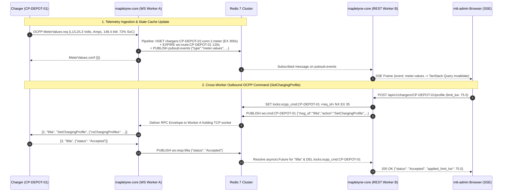

# Caching Policies, Redis Patterns & Memory Hygiene (`CACHING_AND_MEMORY.md`)

**Specification Version:** 3.2.0 (Enterprise Gold Standard)  
**Engine:** Redis 7.2 Alpine (`--appendonly yes --maxmemory 512mb --maxmemory-policy allkeys-lru`)  
**Namespace Standard:** `mtt:{environment}:{tenant_slug}:{resource}:{id}`  
**Scope:** OCPP WebSocket Routing, Live Telemetry Caching, Pub/Sub SSE Fan-Out, Distributed Locks, OTP Rate Limiting, and Memory Leak Prevention

---

## 1. Hierarchical Redis Key Namespacing & TTL Catalog

Every Redis key written by `mapletyne-core` must be constructed through `RedisKeyBuilder` using the 5-segment colon hierarchy:

$$\mathbf{\text{mtt}:\{\text{environment}\}:\{\text{tenant\_slug}\}:\{\text{resource}\}:\{\text{identifier}\} }$$

Unbounded keys without an explicit TTL (other than capped Redis Streams) are strictly prohibited.

| Functional Domain | Redis Key Pattern | Redis Type | Mandatory TTL | Eviction / Refresh Policy |
| :--- | :--- | :---: | :---: | :--- |
| **OCPP WS Socket Routing** | `mtt:{env}:{tenant}:ws:route:{cp_id}` | `STRING` (Pod ID) | `120s` | Refreshed on every OCPP `Heartbeat` / `MeterValues` frame; deleted on socket close. |
| **OCPP Outbound RPC Channel** | `mtt:{env}:{tenant}:ws:cmd:{cp_id}` | `PUBSUB` | Ephemeral | Real-time cross-worker command delivery (`RemoteStart`, `SetChargingProfile`). |
| **Live Charger State** | `mtt:{env}:{tenant}:chargers:{cp_id}:state` | `HASH` | `90s` | Refreshed on `Heartbeat` & `StatusNotification`. |
| **Live Connector Telemetry** | `mtt:{env}:{tenant}:chargers:{cp_id}:conn:{conn_id}:meter` | `HASH` | `300s` | Latest 3-phase `L1/L2/L3` V, A, kW, SoC %, Hz, THD %. |
| **Active Session Accumulator** | `mtt:{env}:{tenant}:sessions:{tx_id}:live` | `HASH` | `86400s` | Running energy Wh, peak kW, dynamic TOU cost accumulator; deleted on `StopTransaction`. |
| **SSE Telemetry Fan-Out** | `mtt:{env}:{tenant}:pubsub:events` | `PUBSUB` | Ephemeral | Pushes `charger.status`, `meter.values`, `session.*`, `ems.telemetry` to SSE clients. |
| **Persistent Event Ledger** | `mtt:{env}:{tenant}:events:stream` | `STREAM` | `MAXLEN ~ 50000` | Capped Redis Stream (`XADD MAXLEN ~ 50000`) for audit replay and webhook workers. |
| **EMS Dynamic Site Cap** | `mtt:{env}:{tenant}:ems:{site_id}:override` | `HASH` | `duration_seconds` | Stores external SCADA power cap (`override_limit_kw`, `reason`); auto-expires to restore default grid limit. |
| **OCPP In-Flight Call Lock** | `mtt:{env}:{tenant}:locks:ocpp_cmd:{cp_id}` | `STRING` (`NX`) | `35s` | Prevents concurrent CSMS-to-Charger CALL collisions per OCPP spec. |
| **EMS Site Rebalance Lock** | `mtt:{env}:{tenant}:locks:ems:{site_id}` | `STRING` (`NX`) | `10s` | Ensures single-worker execution of site load-curtailment calculation. |
| **REST Idempotency Cache** | `mtt:{env}:{tenant}:locks:idemp:{uuid}` | `STRING` (JSON) | `86400s` | Caches HTTP response for `X-Idempotency-Key` headers. |
| **RFID / EMAID Auth Cache** | `mtt:{env}:{tenant}:auth:token:{uid}` | `STRING` (JSON) | `300s` | Sub-millisecond OCPP `Authorize.req` lookup; invalidated immediately on token block. |
| **Keycloak JWKS Public Keys** | `mtt:shared:auth:jwks:{realm}` | `STRING` (JSON) | `3600s` | Cached RS256 public signing keys for zero-latency JWT verification. |
| **Step-1 Registration OTP** | `mtt:{env}:{tenant}:auth:otp:{email_sha256}` | `HASH` | `600s` | Stores hashed 6-digit OTP, pending user payload, and `attempts` counter (max 5). |
| **API Rate Limit Bucket** | `mtt:{env}:{tenant}:ratelimit:{scope}:{id}` | `ZSET` / `STRING` | `60s` | Sliding-window rate limiter counter. |

---

## 2. Live OCPP WebSocket Routing & SSE Fan-Out Architecture



---

## 3. Distributed Lock & Atomic Lua Script Standards

To eliminate race conditions across `mapletyne-core` replicas, all distributed locks use atomic acquisition (`SET key token NX PX milliseconds`) and safe Lua-verified release:

```lua
-- Atomic Lock Release Script (unlock.lua)
if redis.call("get", KEYS[1]) == ARGV[1] then
    return redis.call("del", KEYS[1])
else
    return 0
end
```

- **Heartbeat Offline Detection:** Instead of polling the database for stale chargers, a lightweight background task scans active charger IDs against `mtt:{env}:{tenant}:chargers:{cp_id}:state`. When a charger's key expires after missing 2 consecutive `HeartbeatInterval` cycles, `mapletyne-core` emits a `charger.status` (`Offline`) SSE event and records the connectivity drop.

---

## 4. Python 3.12 Memory Hygiene & Backpressure Defense

1. **Bounded SSE Queues per Client:** Each connected browser client on `GET /api/v1/events/stream` is allocated a bounded `asyncio.Queue(maxsize=256)`. If a slow client fails to drain its TCP socket and the queue reaches 256 messages, the oldest telemetry tick is dropped (`queue.get_nowait()`) or the slow connection is closed with a `retry: 3000` directive—preventing unbounded RAM growth in `mapletyne-core`.
2. **WebSocket Frame Size Limits:** OCPP 1.6-J and 2.0.1 WebSocket listeners enforce `max_size=1_048_576` (1 MiB) and `max_queue=32` per socket to prevent malicious or malfunctioning firmware from exhausting container memory (`1536Mi` limit).
3. **Chunked Database Streaming:** Exporting large session or CDR datasets (`GET /api/v1/sessions` or CSV/PDF exports) uses SQLAlchemy `session.stream_scalars(stmt.execution_options(yield_per=500))` rather than loading full result sets into memory with `.all()`.
4. **Redis Connection Pooling:** A single shared `redis.asyncio.ConnectionPool(max_connections=100, decode_responses=True, health_check_interval=15)` is initialized during FastAPI `lifespan` startup and cleanly closed on shutdown.
