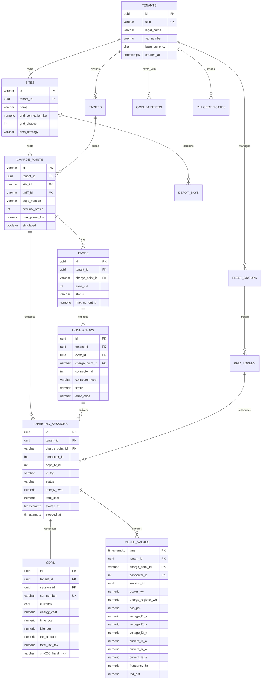

# Database Schema & Entity Relational Models (`tbls` & TimescaleDB Standard)

**Specification Version:** 3.2.0 (Enterprise Gold Standard)  
**Database Engine:** PostgreSQL 16 + TimescaleDB 2.14+ (`ocpp` schema)  
**ORM / Driver:** SQLAlchemy 2.0 Async (`asyncpg`) + Alembic Migrations  
**Tenancy Model:** Deterministic Database-per-Tenant (`mapletyne_{env}_{tenant_slug}_core`) + Row-Level Security (`tenant_id UUID NOT NULL`)

---

## 1. Schema Conventions & Multi-Tenant Invariants

1. **Deterministic Database Naming:** Every tenant cluster follows `{platform}_{environment}_{tenant_slug}_{domain}` (e.g., `mapletyne_prod_fleetalpha_core`) owned by `mtt_{tenant_slug}_user`.
2. **Row-Level Security (RLS) Defense-in-Depth:** Every table in the `ocpp` schema includes `tenant_id UUID NOT NULL REFERENCES ocpp.tenants(id) ON DELETE CASCADE` and enforces:
   ```sql
   ALTER TABLE ocpp.<table_name> ENABLE ROW LEVEL SECURITY;
   CREATE POLICY tenant_isolation_policy ON ocpp.<table_name>
     USING (tenant_id = current_setting('app.current_tenant_id', true)::uuid);
   ```
3. **Primary Keys:** Chronologically sortable **UUIDv7** (`UUID`) for high-volume transactional entities (`sessions`, `cdrs`, `pki_certificates`, `webhook_deliveries`) and deterministic natural/slug keys (`VARCHAR(64)`) scoped by `tenant_id` for hardware identifiers (`charge_points.id`).
4. **Audit Timestamps & Monetary Types:** Every relational table includes `created_at TIMESTAMPTZ NOT NULL DEFAULT NOW()` and `updated_at TIMESTAMPTZ NOT NULL DEFAULT NOW()`. All monetary columns use `NUMERIC(12, 4)` (never `FLOAT` or `REAL`).

---

## 2. Entity-Relationship Diagram (ERD)



---

## 3. Relational Table Catalog (`ocpp` Schema)

### 3.1 `ocpp.tenants` & `ocpp.settings`
Stores the organization legal profile (`AD-10`), white-label branding tokens (`AD-7`), and SMTP configuration (`AD-12`).

| Column | Type | Constraints | Description |
| :--- | :--- | :--- | :--- |
| `id` | `UUID` | `PRIMARY KEY` | Unique tenant UUIDv7 |
| `slug` | `VARCHAR(64)` | `UNIQUE, NOT NULL` | Deterministic slug (e.g., `fleetalpha`) |
| `display_name` | `VARCHAR(128)` | `NOT NULL` | Trading/brand name (`ORG_NAME`) |
| `legal_entity_name` | `VARCHAR(255)` | `NOT NULL` | Registered corporate entity for VAT receipts |
| `tax_vat_id` | `VARCHAR(64)` | `NOT NULL` | Tax / VAT registration identifier |
| `registration_number` | `VARCHAR(64)` | `NULL` | Company house / commercial register number |
| `billing_address` | `JSONB` | `NOT NULL` | Structured street, city, postal_code, country_code |
| `base_currency` | `CHAR(3)` | `NOT NULL DEFAULT 'GBP'` | ISO 4217 currency (`GBP`, `EUR`, `USD`, `CAD`) |
| `branding_config` | `JSONB` | `NOT NULL DEFAULT '{}'` | `primary_color`, `secondary_color`, `accent_color`, `logo_url`, `skin` |
| `smtp_config` | `JSONB` | `NULL` | Encrypted SMTP host, port, username, password, sender_email |
| `created_at` | `TIMESTAMPTZ` | `NOT NULL DEFAULT NOW()` | Creation timestamp |
| `updated_at` | `TIMESTAMPTZ` | `NOT NULL DEFAULT NOW()` | Last update timestamp |

---

### 3.2 `ocpp.sites` & `ocpp.depot_bays`
Models physical charging locations, PCC transformer capacities, and fleet depot parking bays.

| Column (`ocpp.sites`) | Type | Constraints | Description |
| :--- | :--- | :--- | :--- |
| `id` | `VARCHAR(64)` | `PRIMARY KEY` | Site slug (e.g., `depot-north`) |
| `tenant_id` | `UUID` | `NOT NULL, FK -> tenants(id) ON DELETE CASCADE` | Owning tenant |
| `name` | `VARCHAR(128)` | `NOT NULL` | Human-readable site name |
| `address` | `VARCHAR(255)` | `NOT NULL` | Street address |
| `city` | `VARCHAR(100)` | `NOT NULL` | City |
| `country_code` | `CHAR(2)` | `NOT NULL DEFAULT 'GB'` | ISO 3166-1 alpha-2 country code |
| `latitude` | `NUMERIC(9, 6)` | `NOT NULL` | WGS84 latitude |
| `longitude` | `NUMERIC(9, 6)` | `NOT NULL` | WGS84 longitude |
| `timezone` | `VARCHAR(64)` | `NOT NULL DEFAULT 'Europe/London'` | IANA timezone |
| `grid_connection_kw` | `NUMERIC(10, 2)` | `NOT NULL DEFAULT 350.00` | Maximum PCC transformer import capacity (kW) |
| `grid_phases` | `SMALLINT` | `NOT NULL DEFAULT 3` | Electrical phases (`1` or `3`) |
| `nominal_voltage_v` | `SMALLINT` | `NOT NULL DEFAULT 400` | Nominal line-to-line voltage (`400` or `480`) |
| `ems_strategy` | `VARCHAR(32)` | `NOT NULL DEFAULT 'DEPARTURE_DEADLINE'` | `EQUAL_SHARE`, `SOC_PRIORITY`, `DEPARTURE_DEADLINE`, `AUTONOMOUS` |
| `created_at` | `TIMESTAMPTZ` | `NOT NULL DEFAULT NOW()` | Creation timestamp |
| `updated_at` | `TIMESTAMPTZ` | `NOT NULL DEFAULT NOW()` | Last update timestamp |

| Column (`ocpp.depot_bays`) | Type | Constraints | Description |
| :--- | :--- | :--- | :--- |
| `id` | `BIGSERIAL` | `PRIMARY KEY` | Internal bay ID |
| `tenant_id` | `UUID` | `NOT NULL, FK -> tenants(id) ON DELETE CASCADE` | Owning tenant |
| `site_id` | `VARCHAR(64)` | `NOT NULL, FK -> sites(id) ON DELETE CASCADE` | Parent depot site |
| `bay_number` | `VARCHAR(32)` | `NOT NULL` | Physical bay label (`BAY-01`) |
| `charge_point_id` | `VARCHAR(64)` | `NOT NULL, FK -> charge_points(id) ON DELETE RESTRICT` | Assigned EVSE |
| `connector_id` | `SMALLINT` | `NOT NULL DEFAULT 1` | Assigned connector number |
| `bay_type` | `VARCHAR(32)` | `NOT NULL DEFAULT 'DC_FAST'` | `AC_TETHERED`, `DC_FAST`, `PANTROGRAPH_HV` |
| `max_bay_power_kw` | `NUMERIC(10, 2)` | `NOT NULL` | Rated bay output (kW) |
| `assigned_vehicle_plate` | `VARCHAR(32)` | `NULL` | Docked fleet vehicle license plate / VIN |
| `target_departure_at` | `TIMESTAMPTZ` | `NULL` | Scheduled fleet dispatch departure timestamp |
| `target_soc_pct` | `SMALLINT` | `NOT NULL DEFAULT 90` | Target state of charge (`10`–`100`%) |

---

### 3.3 `ocpp.charge_points`, `ocpp.evses`, & `ocpp.connectors`
Models the 3-tier OCPP 2.0.1 Device Model hierarchy (`ChargingStation -> EVSE -> Connector`) while remaining backward-compatible with OCPP 1.6-J (`connectorId >= 1`).

| Column (`ocpp.charge_points`) | Type | Constraints | Description |
| :--- | :--- | :--- | :--- |
| `id` | `VARCHAR(64)` | `PRIMARY KEY` | ChargeBoxIdentity / Station ID (`CP-DEPOT-01`) |
| `tenant_id` | `UUID` | `NOT NULL, FK -> tenants(id) ON DELETE CASCADE` | Owning tenant |
| `site_id` | `VARCHAR(64)` | `NULL, FK -> sites(id) ON DELETE SET NULL` | Physical site |
| `tariff_id` | `VARCHAR(64)` | `NULL, FK -> tariffs(id) ON DELETE SET NULL` | Active pricing tariff |
| `display_name` | `VARCHAR(128)` | `NOT NULL` | Operator-friendly name |
| `vendor` | `VARCHAR(64)` | `NOT NULL DEFAULT 'Generic'` | `chargePointVendor` |
| `model` | `VARCHAR(64)` | `NOT NULL DEFAULT 'Virtual-EVSE'` | `chargePointModel` |
| `serial_number` | `VARCHAR(64)` | `NULL` | `chargePointSerialNumber` |
| `firmware_version` | `VARCHAR(64)` | `NULL` | Reported firmware version |
| `ocpp_version` | `VARCHAR(16)` | `NOT NULL DEFAULT '2.0.1'` | `'1.6'` or `'2.0.1'` |
| `security_profile` | `SMALLINT` | `NOT NULL DEFAULT 2` | `1` (Unsecured), `2` (TLS + Basic Auth), `3` (mTLS X.509) |
| `basic_auth_password_hash` | `VARCHAR(255)` | `NULL` | Argon2id hash for OCPP Security Profile 1/2 |
| `max_power_kw` | `NUMERIC(10, 2)` | `NOT NULL DEFAULT 22.00` | Nameplate hardware max power (kW) |
| `phases` | `SMALLINT` | `NOT NULL DEFAULT 3` | Wired electrical phases (`1` or `3`) |
| `latitude` | `NUMERIC(9, 6)` | `NULL` | Station GPS latitude |
| `longitude` | `NUMERIC(9, 6)` | `NULL` | Station GPS longitude |
| `address` | `VARCHAR(255)` | `NULL` | Street address override |
| `city` | `VARCHAR(100)` | `NULL` | City override |
| `simulated` | `BOOLEAN` | `NOT NULL DEFAULT FALSE` | True if virtual charger-farm node |
| `last_boot_at` | `TIMESTAMPTZ` | `NULL` | Last `BootNotification` timestamp |
| `last_heartbeat_at` | `TIMESTAMPTZ` | `NULL` | Last `Heartbeat` timestamp |
| `created_at` | `TIMESTAMPTZ` | `NOT NULL DEFAULT NOW()` | Provisioned timestamp |
| `updated_at` | `TIMESTAMPTZ` | `NOT NULL DEFAULT NOW()` | Last metadata update |

| Column (`ocpp.connectors`) | Type | Constraints | Description |
| :--- | :--- | :--- | :--- |
| `id` | `UUID` | `PRIMARY KEY` | Connector UUIDv7 |
| `tenant_id` | `UUID` | `NOT NULL, FK -> tenants(id) ON DELETE CASCADE` | Owning tenant |
| `charge_point_id` | `VARCHAR(64)` | `NOT NULL, FK -> charge_points(id) ON DELETE CASCADE` | Parent station |
| `evse_uid` | `SMALLINT` | `NOT NULL DEFAULT 1` | OCPP 2.0.1 EVSE ID (`>= 1`) |
| `connector_id` | `SMALLINT` | `NOT NULL` | Connector index (`1`, `2`, ...) |
| `connector_type` | `VARCHAR(32)` | `NOT NULL DEFAULT 'CCS2'` | `CCS2`, `CCS1`, `Type2`, `CHAdeMO`, `NACS` |
| `power_type` | `VARCHAR(16)` | `NOT NULL DEFAULT 'DC'` | `AC_1_PHASE`, `AC_3_PHASE`, `DC` |
| `max_voltage_v` | `SMALLINT` | `NOT NULL DEFAULT 1000` | Rated max voltage (V) |
| `max_amperage_a` | `SMALLINT` | `NOT NULL DEFAULT 300` | Rated max current (A) |
| `max_electric_power_kw` | `NUMERIC(10, 2)` | `NOT NULL DEFAULT 150.00` | Rated max power (kW) |
| `status` | `VARCHAR(32)` | `NOT NULL DEFAULT 'Available'` | `Available`, `Preparing`, `Charging`, `SuspendedEV`, `SuspendedEVSE`, `Finishing`, `Reserved`, `Unavailable`, `Faulted` |
| `error_code` | `VARCHAR(64)` | `NOT NULL DEFAULT 'NoError'` | OCPP `ChargePointErrorCode` |
| `updated_at` | `TIMESTAMPTZ` | `NOT NULL DEFAULT NOW()` | Last `StatusNotification` timestamp |

*Unique Constraint:* `UNIQUE (tenant_id, charge_point_id, evse_uid, connector_id)`

---

### 3.4 `ocpp.charging_sessions` & `ocpp.cdrs`
Tracks live and historical charging transactions and their immutable fiscal Charge Detail Records (CDRs).

| Column (`ocpp.charging_sessions`) | Type | Constraints | Description |
| :--- | :--- | :--- | :--- |
| `id` | `UUID` | `PRIMARY KEY` | Session UUIDv7 (`ses_...`) |
| `tenant_id` | `UUID` | `NOT NULL, FK -> tenants(id) ON DELETE CASCADE` | Owning tenant |
| `charge_point_id` | `VARCHAR(64)` | `NOT NULL, FK -> charge_points(id) ON DELETE RESTRICT` | Station ID |
| `evse_uid` | `SMALLINT` | `NOT NULL DEFAULT 1` | EVSE index |
| `connector_id` | `SMALLINT` | `NOT NULL` | Connector index |
| `ocpp_tx_id` | `INTEGER` | `NOT NULL` | Integer `transactionId` (1.6) or hashed sequence (2.0.1) |
| `ocpp_transaction_uuid` | `VARCHAR(36)` | `NULL` | Native OCPP 2.0.1 `transactionId` string |
| `id_tag` | `VARCHAR(64)` | `NOT NULL` | Authorizing RFID UID, EMAID, or App Token |
| `auth_method` | `VARCHAR(32)` | `NOT NULL DEFAULT 'RFID'` | `RFID`, `ISO15118_PNC`, `REMOTE_APP`, `OCPI_ROAMING`, `ADHOC_PAYMENT` |
| `driver_email` | `VARCHAR(255)` | `NULL` | Driver email for receipt dispatch |
| `tariff_id` | `VARCHAR(64)` | `NULL, FK -> tariffs(id)` | Applied tariff snapshot reference |
| `status` | `VARCHAR(24)` | `NOT NULL DEFAULT 'active'` | `active`, `completed`, `failed`, `invalidated` |
| `meter_start_wh` | `NUMERIC(14, 2)` | `NOT NULL DEFAULT 0` | Starting energy register (Wh) |
| `meter_stop_wh` | `NUMERIC(14, 2)` | `NULL` | Ending energy register (Wh) |
| `energy_kwh` | `NUMERIC(10, 4)` | `NOT NULL DEFAULT 0.0000` | Net energy delivered ($\text{kWh}$) |
| `peak_power_kw` | `NUMERIC(10, 2)` | `NOT NULL DEFAULT 0.00` | Peak power reached during session |
| `start_soc_pct` | `SMALLINT` | `NULL` | Initial EV Battery SoC (%) |
| `current_soc_pct` | `SMALLINT` | `NULL` | Latest/Final EV Battery SoC (%) |
| `stop_reason` | `VARCHAR(64)` | `NULL` | `Local`, `Remote`, `EVDisconnected`, `EmergencyStop`, `DeAuthorized` |
| `total_cost` | `NUMERIC(12, 4)` | `NOT NULL DEFAULT 0.0000` | Accrued or final gross cost |
| `currency` | `CHAR(3)` | `NOT NULL DEFAULT 'GBP'` | ISO 4217 currency |
| `stripe_payment_intent_id` | `VARCHAR(128)` | `NULL` | Pre-authorized Stripe PaymentIntent ID |
| `simulated` | `BOOLEAN` | `NOT NULL DEFAULT FALSE` | True if generated by virtual charger farm |
| `started_at` | `TIMESTAMPTZ` | `NOT NULL` | Hardware transaction start timestamp |
| `stopped_at` | `TIMESTAMPTZ` | `NULL` | Hardware transaction stop timestamp |
| `created_at` | `TIMESTAMPTZ` | `NOT NULL DEFAULT NOW()` | Record creation timestamp |
| `updated_at` | `TIMESTAMPTZ` | `NOT NULL DEFAULT NOW()` | Last update timestamp |

| Column (`ocpp.cdrs`) | Type | Constraints | Description |
| :--- | :--- | :--- | :--- |
| `id` | `UUID` | `PRIMARY KEY` | Immutable CDR UUIDv7 |
| `tenant_id` | `UUID` | `NOT NULL, FK -> tenants(id) ON DELETE RESTRICT` | Owning tenant |
| `session_id` | `UUID` | `UNIQUE, NOT NULL, FK -> charging_sessions(id) ON DELETE RESTRICT` | Source session |
| `cdr_number` | `VARCHAR(64)` | `UNIQUE, NOT NULL` | Sequential fiscal invoice number (`MTT-2026-000482`) |
| `currency` | `CHAR(3)` | `NOT NULL` | ISO 4217 currency code |
| `total_energy_kwh` | `NUMERIC(10, 4)` | `NOT NULL` | Certified billed energy (kWh) |
| `charging_duration_sec` | `INTEGER` | `NOT NULL` | Active energy transfer duration (seconds) |
| `idle_duration_sec` | `INTEGER` | `NOT NULL DEFAULT 0` | Post-charge parking/idle duration (seconds) |
| `flat_fee_cost` | `NUMERIC(12, 4)` | `NOT NULL DEFAULT 0.0000` | Session start flat fee |
| `energy_cost` | `NUMERIC(12, 4)` | `NOT NULL` | Sum of TOU energy period costs |
| `time_cost` | `NUMERIC(12, 4)` | `NOT NULL DEFAULT 0.0000` | Active duration cost |
| `idle_cost` | `NUMERIC(12, 4)` | `NOT NULL DEFAULT 0.0000` | Overstay idle fee cost |
| `subtotal_excl_tax` | `NUMERIC(12, 4)` | `NOT NULL` | Net subtotal before VAT/tax |
| `tax_rate_pct` | `NUMERIC(5, 2)` | `NOT NULL DEFAULT 20.00` | Applied VAT/tax rate (%) |
| `tax_amount` | `NUMERIC(12, 4)` | `NOT NULL` | Calculated tax amount |
| `total_incl_tax` | `NUMERIC(12, 2)` | `NOT NULL` | Final billed amount (`ROUND_HALF_UP`) |
| `tariff_breakdown_json` | `JSONB` | `NOT NULL` | OCPI 2.2.1 `charging_periods` breakdown & legal entity snapshot |
| `signed_meter_data` | `TEXT` | `NULL` | Eichrecht OCMF / transparency software signature |
| `sha256_fiscal_hash` | `CHAR(64)` | `NOT NULL` | SHA-256 tamper-evident digest of CDR fields |
| `created_at` | `TIMESTAMPTZ` | `NOT NULL DEFAULT NOW()` | Immutable issuance timestamp |

---

### 3.5 `ocpp.tariffs`, `ocpp.rfid_tokens`, `ocpp.fleet_groups`, `ocpp.ocpi_partners`, & `ocpp.pki_certificates`

| Table | Primary Key | Key Columns & JSONB Structures | Purpose |
| :--- | :--- | :--- | :--- |
| **`ocpp.tariffs`** | `id VARCHAR(64)` | `tenant_id`, `name`, `currency`, `energy_rate NUMERIC(10,4)`, `time_rate NUMERIC(10,4)`, `idle_rate NUMERIC(10,4)`, `flat_fee NUMERIC(10,4)`, `tax_pct NUMERIC(5,2)`, `tou_periods JSONB` (`[{start_time, end_time, days_of_week, rate_kwh}]`) | Static & Time-of-Use (TOU) tariff schedules and dynamic spot margins. |
| **`ocpp.fleet_groups`** | `id UUID` | `tenant_id`, `name`, `billing_email`, `billing_address`, `billing_reference`, `monthly_credit_limit NUMERIC(12,2)`, `discount_pct NUMERIC(5,2)` | Corporate fleet cost centers and consolidated monthly billing accounts. |
| **`ocpp.rfid_tokens`** | `id UUID` | `tenant_id`, `uid VARCHAR(64) UNIQUE`, `type` (`RFID`\|`EMAID`\|`APP_USER`), `status` (`ACTIVE`\|`BLOCKED`\|`EXPIRED`), `group_id UUID FK`, `driver_name`, `driver_email`, `valid_from`, `valid_until` | Driver RFID tags and ISO 15118 Contract EMAIDs synced to chargers via `SendLocalList`. |
| **`ocpp.ocpi_partners`** | `id UUID` | `tenant_id`, `party_id CHAR(3)`, `country_code CHAR(2)`, `role` (`EMSP`\|`CPO`\|`HUB`), `name`, `versions_url`, `token_a`, `token_b`, `token_c_encrypted`, `base_tariff_id FK`, `status`, `last_sync_at` | OCPI 2.2.1 roaming peers (Hubject, Gireve, bilateral eMSPs). |
| **`ocpp.pki_certificates`** | `id UUID` | `tenant_id`, `serial_number VARCHAR(64) UNIQUE`, `cert_type` (`V2G_ROOT`\|`SECC_SUB_CA`\|`MO_SUB_CA`\|`SECC_LEAF`\|`EMAID_CONTRACT`), `subject_dn`, `charge_point_id FK`, `emaid`, `cert_pem TEXT`, `status` (`VALID`\|`REVOKED`\|`EXPIRED`), `not_before`, `not_after`, `revoked_at`, `revocation_reason` | ISO 15118-20 & OCPP 2.0.1 Security Profile 3 X.509 certificate inventory. |

---

## 4. TimescaleDB Hypertable Specification (`ocpp.meter_values`)

High-frequency 3-phase electrical telemetry is ingested into `ocpp.meter_values`:

```sql
CREATE TABLE ocpp.meter_values (
    time                TIMESTAMPTZ     NOT NULL,
    tenant_id           UUID            NOT NULL,
    charge_point_id     VARCHAR(64)     NOT NULL,
    connector_id        SMALLINT        NOT NULL,
    session_id          UUID            NULL,
    power_kw            NUMERIC(10, 3)  NOT NULL DEFAULT 0.000,
    reactive_power_kvar NUMERIC(10, 3)  NULL,
    energy_register_wh  NUMERIC(14, 2)  NOT NULL,
    soc_pct             SMALLINT        NULL,
    voltage_l1_v        NUMERIC(7, 2)   NULL,
    voltage_l2_v        NUMERIC(7, 2)   NULL,
    voltage_l3_v        NUMERIC(7, 2)   NULL,
    current_l1_a        NUMERIC(8, 2)   NULL,
    current_l2_a        NUMERIC(8, 2)   NULL,
    current_l3_a        NUMERIC(8, 2)   NULL,
    power_factor        NUMERIC(4, 3)   NULL,
    frequency_hz        NUMERIC(5, 2)   NULL,
    thd_pct             NUMERIC(5, 2)   NULL,
    temperature_c       NUMERIC(5, 2)   NULL
);

-- Convert to TimescaleDB Hypertable (7-day time chunks)
SELECT create_hypertable('ocpp.meter_values', 'time', chunk_time_interval => INTERVAL '7 days');

-- Composite index for real-time oscilloscope & session curve queries
CREATE INDEX idx_meter_values_cp_conn_time 
    ON ocpp.meter_values (tenant_id, charge_point_id, connector_id, time DESC);
CREATE INDEX idx_meter_values_session_time 
    ON ocpp.meter_values (tenant_id, session_id, time ASC) WHERE session_id IS NOT NULL;

-- Enable Native Columnar Compression after 14 days
ALTER TABLE ocpp.meter_values SET (
    timescaledb.compress,
    timescaledb.compress_segmentby = 'tenant_id, charge_point_id, connector_id',
    timescaledb.compress_orderby = 'time DESC'
);
SELECT add_compression_policy('ocpp.meter_values', INTERVAL '14 days');
SELECT add_retention_policy('ocpp.meter_values', INTERVAL '365 days');
```
