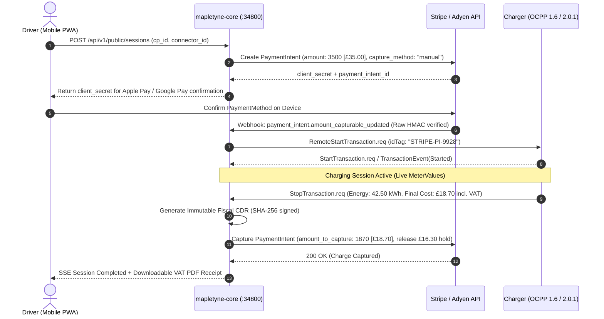
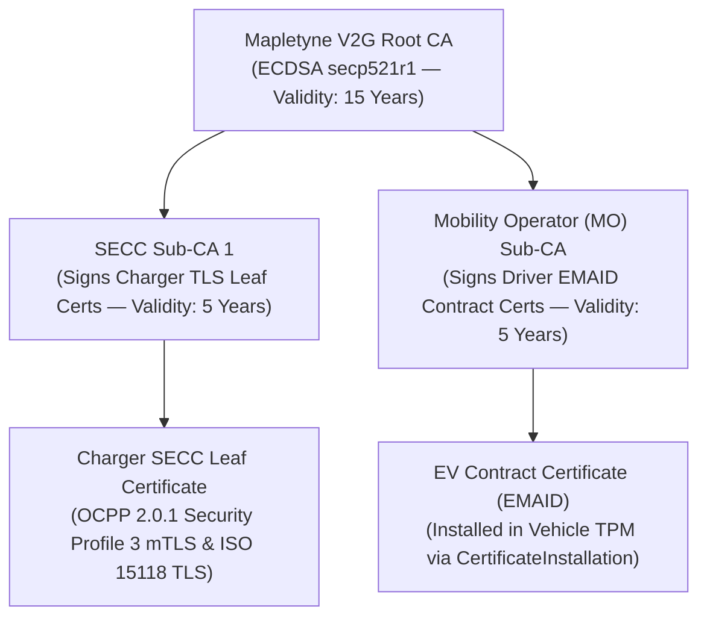

# Third-Party Integrations, OCPI 2.2.1 Roaming, V2G PKI & Webhooks (`INTEGRATIONS_AND_WEBHOOKS.md`)

**Specification Version:** 3.2.0 (Enterprise Gold Standard)  
**Lead Architects:** Winston (System Architect), Pax (OCPP & OCPI Specialist), Volt (Electrical & Grid Systems Lead)  
**Scope:** Keycloak 26 IAM, Stripe & Adyen Pre-Auth/Settlement, Hubject/Gireve OCPI 2.2.1 Roaming, ISO 15118-20 V2G PKI Vault, ENTSO-E Spot Pricing, and Svix-Standard Outbound/Inbound Webhooks

---

## 1. External Integration Matrix

| Integration Partner / System | Protocol / Standard | Direction | Auth Mechanism | Secret / Config Variable | Target / Local Endpoint |
| :--- | :--- | :---: | :--- | :--- | :--- |
| **Keycloak 26 IAM** | OIDC / OAuth 2.0 / JWKS | Bidirectional | RS256 JWKS + Client Secret | `KEYCLOAK_CLIENT_SECRET`, `KEYCLOAK_ADMIN_PASSWORD` | `POST /realms/opencpo/protocol/openid-connect/token` |
| **Stripe Payments** | REST + Raw-Buffer Webhook | Bidirectional | Bearer `sk_live_*` + HMAC-SHA256 | `STRIPE_SECRET_KEY`, `STRIPE_WEBHOOK_SECRET` | `POST /api/v1/public/payments/webhook/stripe` |
| **Adyen e-Commerce & POS** | REST + HMAC Webhook | Bidirectional | `X-API-Key` + HMAC-SHA256 | `ADYEN_API_KEY`, `ADYEN_HMAC_KEY` | `POST /api/v1/public/payments/webhook/adyen` |
| **OCPI 2.2.1 Hubs (Hubject / Gireve)** | OCPI 2.2.1 REST JSON | Bidirectional | `Authorization: Token <base64>` | Stored encrypted in `ocpp.ocpi_partners` | `/api/v1/ocpi/2.2.1/{module}` |
| **ISO 15118-20 V2G PKI / MO** | X.509 / OCSP / CRL (DER/PEM) | Bidirectional | ECDSA `secp256r1` / mTLS | `PKI_KEY_PASSPHRASE` | `/api/v1/pki/*` & OCPP 2.0.1 `SignCertificate` |
| **SkyOp EMS / SCADA Aggregators** | REST JSON / Modbus Gateway | Inbound | `X-API-Key` (`MANAGEMENT_API_KEY`) | `MANAGEMENT_API_KEY` | `POST /api/v1/ems/override`, `POST /api/v1/ems/telemetry` |
| **ENTSO-E / NordPool Spot Market** | REST XML/JSON | Outbound Poll | API Security Token | `ENTSOE_API_TOKEN` | Hourly cron $\rightarrow$ `/api/v1/pricing/current` |
| **Customer n8n / ERP Webhooks** | HTTPS JSON + HMAC-SHA256 | Outbound Push | `X-Mapletyne-Signature-256` | Per-webhook `secret` in `ocpp.webhooks` | Customer-configured HTTPS URL |

---

## 2. Inbound Webhook Security Invariants

1. **Mandatory Raw Byte Buffer Verification:** FastAPI routes under `/api/v1/public/payments/webhook/*` MUST read `raw_body = await request.body()` directly without parsing through Pydantic/JSON middleware first. Any modification of whitespace or key ordering invalidates cryptographic signatures.
2. **Replay Attack Protection (300-Second Window):** All signed webhooks must include a unix timestamp (e.g., `Stripe-Signature: t=1761068224,v1=...` or `X-Mapletyne-Timestamp`). Payloads where $|\text{now} - t| > 300\text{ seconds}$ are immediately rejected with `400 Bad Request`.
3. **Event Deduplication:** Verified webhook `event.id` values are atomically recorded in Redis (`mtt:{env}:{tenant}:webhooks:seen:{event_id}`, TTL `86400s`). Duplicate deliveries immediately return `200 OK` without re-enqueueing jobs.
4. **Fast Acknowledge (< 200ms):** Webhook controllers verify the HMAC signature, persist the event ID, enqueue the background worker job (`billing-high`), and return `200 OK` within 200ms.

---

## 3. Payment Pre-Authorization & Capture Flow (Stripe / Adyen)

Ad-hoc QR drivers (`mapletyne-chargeapp`) and California/UK AFIR-compliant contactless payment terminals follow a two-phase pre-authorization and exact settlement flow:

---

## 4. OCPI 2.2.1 Roaming Architecture (Hubject / Gireve / Peer eMSPs)

`mapletyne-core` implements both **OCPI 2.2.1 CPO** role (allowing external eMSP drivers to charge on Mapletyne stations) and **eMSP** role:
- **Credentials & Version Handshake:** Peers register via `POST /api/v1/ocpi/partners` supplying `TOKEN_A`. `mapletyne-core` exchanges `versions` and `credentials`, generating a scoped, Base64-encoded `TOKEN_C` stored encrypted (`AES-256-GCM`) in `ocpp.ocpi_partners`.
- **Supported OCPI 2.2.1 Modules:**
  - `locations`: Real-time push (`PATCH`) of EVSE/Connector statuses (`AVAILABLE`, `CHARGING`, `INOPERATIVE`) within 3 seconds of an OCPP `StatusNotification`.
  - `tokens`: Pull and real-time `POST /commands/AUTHORIZE` verification for roaming RFID and App tokens.
  - `commands`: Inbound `START_SESSION`, `STOP_SESSION`, `RESERVE_NOW`, and `UNLOCK_CONNECTOR` mapped directly to OCPP WebSocket calls with asynchronous callback delivery to the eMSP `response_url`.
  - `tariffs`: Automated synchronization of TOU tariff elements (`ENERGY`, `FLAT`, `PARKING_TIME`).
  - `sessions` & `cdrs`: Near-real-time session updates and post-session immutable CDR delivery (`POST /ocpi/emsp/2.2.1/cdrs`).

---

## 5. ISO 15118-20 Plug & Charge PKI Hierarchy

1. **Automated SECC CSR Signing (`SignCertificate.req`):** When an OCPP 2.0.1 charger sends `SignCertificate.req(certificateType="ChargingStationCertificate" | "V2GCertificate", csr="<PEM>")`, `mapletyne-core` verifies the CSR subject against `charge_point_id`, signs the leaf certificate using the SECC Sub-CA key in an off-loop thread, records the serial in `ocpp.pki_certificates`, and returns the PEM chain via `CertificateSigned.req`.
2. **Real-Time OCSP & CRL Verification:** During ISO 15118 `Authorize.req`, the vehicle's contract certificate chain and OCSP staples are validated against `ocpp.pki_certificates` and the local CRL (`GET /api/v1/pki/crl`) in `< 50ms`.

---

## 6. Outbound Customer Webhooks & n8n Automation (`/api/v1/events/webhooks`)

Enterprise operators and n8n workflows can subscribe to real-time CSMS domain events via `POST /api/v1/events/webhooks`:

### 6.1 Subscribable Event Types
- `charger.online`, `charger.offline`, `charger.faulted`, `charger.healed`
- `session.started`, `session.meter_updated`, `session.stopped`, `session.failed`
- `cdr.created`, `payment.captured`, `payment.failed`
- `ems.curtailment_active`, `ems.override_applied`, `ems.overload_warning`
- `pki.certificate_issued`, `pki.certificate_revoked`, `pki.certificate_expiring`

### 6.2 Outbound Webhook Signature Format (Svix / Standard Webhooks Compatible)
Every outbound `POST` request from the `webhooks.dispatch_event` worker includes:
- `X-Mapletyne-Event`: Event type (e.g., `cdr.created`)
- `X-Mapletyne-Delivery-Id`: Unique UUIDv7 (`whd_0192b0...`)
- `X-Mapletyne-Timestamp`: Unix epoch seconds (`1761068224`)
- `X-Mapletyne-Signature-256`: `v1=<hex(HMAC-SHA256(secret, "{delivery_id}.{timestamp}.{raw_json_body}"))>`
