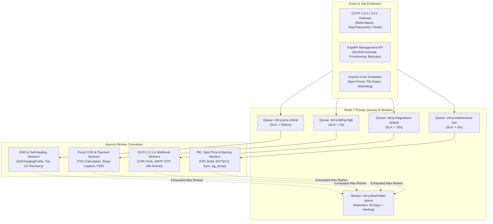

# Background Workers, Asynchronous Queues & Scheduled Jobs (`QUEUES_AND_JOBS.md`)

**Specification Version:** 3.2.0 (Enterprise Gold Standard)  
**Queue Broker:** Redis 7 (`arq` AsyncIO Worker Pool + Redis Streams `XREADGROUP`)  
**Latency Budget:** Any operation exceeding **200ms** or communicating with external networks MUST execute asynchronously outside the HTTP/WebSocket request path.

---

## 1. Queue Topology & Worker Isolation

`mapletyne-core` partitions background workloads into four priority queues backed by Redis 7 to guarantee that real-time electrical curtailment (`ems-critical`) is never blocked by bulk PDF invoice generation or OCPI catalog synchronization.

---

## 2. Comprehensive Job Catalog, Retry Policies & DLQ Configuration

| Job Name | Target Queue | Trigger Source | Max Retries | Backoff Strategy | Timeout | Dead-Letter Queue (DLQ) & Failure Action |
| :--- | :--- | :--- | :---: | :--- | :---: | :--- |
| `ems.rebalance_site_power` | `ems-critical` | `MeterValues`, `POST /ems/override`, `POST /ems/telemetry`, or 5s tick | `3` | Exponential (`500ms`, `1s`, `2s`) | `10s` | `mtt:q:dlq:ems` — Emits `ems.degraded` alert; charger fallback `ChargingStationMaxProfile` remains active on hardware. |
| `watchdog.heal_faulted_evse` | `ems-critical` | `StatusNotification` with fault `error_code != NoError` | `2` | Fixed (`15s` delay before Tier 1 `UnlockConnector`, `90s` before Tier 2 `SoftReset`) | `45s` | `mtt:q:dlq:watchdog` — Sets EVSE `Inoperative` and dispatches PagerDuty/webhook alert to `site-operator`. |
| `telemetry.flush_timescaledb` | `ems-critical` | Micro-batch buffer (every `1s` or `250` OCPP meter frames) | `5` | Exponential (`1s` base, `2x` multiplier) | `15s` | `mtt:q:dlq:telemetry` — Re-queues batch into Redis fallback stream (`mtt:{env}:{tenant}:telemetry:spooled`). |
| `billing.finalize_cdr_and_capture`| `billing-high` | `StopTransaction` (1.6) / `TransactionEvent(Ended)` (2.0.1) | `5` | Exponential (`2s` base + random jitter) | `30s` | `mtt:q:dlq:billing` — Flags session `billing_pending_review` and alerts `billing-manager`. |
| `billing.generate_vat_receipt_pdf`| `billing-high` | Completion of `billing.finalize_cdr_and_capture` | `3` | Exponential (`3s` base) | `20s` | `mtt:q:dlq:billing` — Retries on-demand when driver requests `/api/v1/public-sessions/receipts`. |
| `auth.send_registration_otp_email`| `billing-high` | `POST /api/v1/public/account/register` (Step 1) | `3` | Exponential (`1s`, `2s`, `4s`) | `10s` | `mtt:q:dlq:email` — Logs SMTP transport error; user can trigger OTP resend after 60s. |
| `ocpi.push_cdr_to_emsp` | `integrations-default` | Roaming session CDR finalized | `8` | Exponential (`5s` base up to `1h`) | `25s` | `mtt:q:dlq:ocpi` — Persists failed delivery in `ocpp.ocpi_sync_log` for manual `/ocpi/partners/{id}/sync`. |
| `ocpi.sync_partner_locations` | `integrations-default` | `POST /api/v1/ocpi/partners/{id}/sync` or Charger status change | `5` | Exponential (`5s` base) | `60s` | `mtt:q:dlq:ocpi` — Records HTTP status & partner payload error. |
| `webhooks.dispatch_event` | `integrations-default` | Any subscribed CSMS event (`session.stopped`, `charger.faulted`, etc.) | `6` | Exponential (`2s`, `4s`, `8s`, `16s`, `32s`, `64s`) | `10s` | `mtt:q:dlq:webhooks` — Increments `failure_count`; auto-disables webhook endpoint after 50 consecutive failures. |
| `pricing.sync_spot_market` | `maintenance-low` | Cron (`0 * * * *` hourly & `15 13 * * *` CET day-ahead publish) | `4` | Linear (`60s` delay) | `30s` | `mtt:q:dlq:maintenance` — Retains last known valid spot price bounded by `price_floor` and `price_cap`. |
| `pki.rebuild_crl_and_check_expiry`| `maintenance-low` | Cron (`0 */6 * * *`) or immediate upon `POST /api/v1/pki/revoke` | `3` | Exponential (`5s` base) | `30s` | `mtt:q:dlq:pki` — Alerts `cpo-admin` if Root/Sub-CA CRL signing fails. |
| `admin.create_tenant_backup` | `maintenance-low` | `POST /api/v1/admin/backups` or nightly Cron (`0 2 * * *`) | `2` | Linear (`120s` delay) | `600s` | `mtt:q:dlq:backups` — Cleans up partial `.sql.gz.enc` artifact and notifies `cpo-admin`. |

---

## 3. Core Autonomous Workflows

### 3.1 Autonomous EMS Peak Shaving & Fleet Departure Optimization (`ems.rebalance_site_power`)
1. **Acquire Site Lock:** Acquires `mtt:{env}:{tenant}:locks:ems:{site_id}` (`10s` TTL).
2. **Read Live Power Balance:** Fetches `grid_connection_kw`, active external SCADA override (`mtt:{env}:{tenant}:ems:{site_id}:override`), building baseload (`building_kw`), solar PV generation (`solar_kw`), and BESS discharge (`battery_kw`).
3. **Compute Priority Weights:** Queries all bays in `status = 'Charging'` at `site_id`. For each bay $i$, calculates urgency score $W_i$:
   $$W_i = \frac{(\text{target\_soc\_pct}_i - \text{current\_soc\_pct}_i) \times \text{BatteryCapacity\_kWh}_i}{\max\left(0.25, \text{hours\_until\_departure}_i\right)}$$
4. **Allocate & Dispatch:** Distributes available headroom $P_{\text{available\_ev\_kw} }$ proportionally to $W_i$ (clamped between hardware minimum `6A` per phase and `max_bay_power_kw`). If a charger's new setpoint differs from its active profile by $> 1.0\text{ kW}$, dispatches OCPP `SetChargingProfile.req` (`ChargingProfilePurpose = TxProfile`, `stackLevel = 10`) in parallel via `asyncio.gather`.

### 3.2 Autonomous Two-Tier Self-Healing Watchdog (`watchdog.heal_faulted_evse`)
- **Fault Classification:**
  - **Recoverable Transient Faults:** `ConnectorLockFailure`, `EVCommunicationError`, `ReaderFailure`, `WeakSignal`, `OtherError`.
  - **Critical Electrical Safety Faults (Never Auto-Reset):** `GroundFailure`, `OverCurrentFailure`, `OverVoltage`, `HighTemperature`, `PowerSwitchFailure`.
- **Execution Sequence:**
  1. On a **Critical Electrical Safety Fault**, immediately send `ChangeAvailability(Inoperative)`, mark the connector `Faulted (Safety Lockout)`, and dispatch a high-priority webhook/email alert.
  2. On a **Recoverable Transient Fault**, wait 15 seconds to confirm fault persistence, then execute **Tier 1 Recovery**: send `UnlockConnector.req`.
  3. Schedule a follow-up check in 90 seconds. If the connector remains `Faulted` and no active energy transfer is occurring, execute **Tier 2 Recovery**: send `Reset.req(type="Soft")`.
  4. If the fault persists after Tier 2, escalate to human operator (`Faulted - Manual Intervention Required`) and suppress further automated resets for 6 hours to prevent boot-looping hardware.

---

## 4. Worker Idempotency & Graceful Shutdown Invariants

1. **Strict Job Idempotency:** Every job payload includes a deterministic `job_id` (e.g., `cdr_finalize:{tenant_slug}:{session_id}` or `ocpi_cdr:{partner_id}:{cdr_id}`). Before executing side effects, the worker checks `mtt:{env}:{tenant}:jobs:completed:{job_id}` (`SET NX EX 86400`).
2. **Graceful `SIGTERM` Drain:** Upon receiving `SIGTERM`, worker coroutines stop polling new jobs from Redis queues, await completion of active jobs for up to **20 seconds**, persist any unfinished state back to the queue, and close database and Redis pools cleanly.
