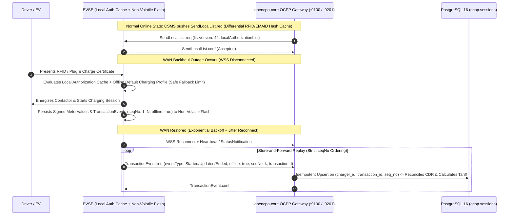

# Site Reliability Engineering (SRE), SLOs, Offline Resilience & Observability

```yaml
title: Mapletyne MTT Charge SRE, SLO/SLI & Disaster Recovery Specification
version: "2.0.0"
date: "2026-10-21"
status: approved
author: Murat (Master Test Architect & SecureCoder Lead) & Winston (System Architect)
scope: SLIs/SLOs, OCPP WebSocket Resilience, Autonomous Peak Shaving Loop, Offline CDR Store-and-Forward, K8s Rolling Updates, Observability
components: [opencpo-core, mtt-admin, opencpo-charge-app, keycloak-26, postgresql-16, redis-7, nginx, prometheus, grafana, langfuse]
```

---

## 1. Service Level Indicators (SLIs) & Service Level Objectives (SLOs)

Mapletyne MTT Charge enforces tiered production SLOs aligned with **Google SRE error-budget principles** and the statutory **99% public charging reliability mandate (UK PCPR 2023 / EU AFIR)**:

| Service / Control Loop | Service Level Indicator (SLI) | SLO Target | Error Budget (30-Day Window) | Alert Burn-Rate Trigger |
| :--- | :--- | :--- | :--- | :--- |
| **OCPP 1.6J & 2.0.1 WSS Gateway (`:9100` / `:9201`)** | Successful WebSocket handshake & bidirectional Ping/Pong heartbeat continuity | **99.95% Uptime** | **21.6 minutes / month** | Page P1 if 2% budget consumed in 1 hour |
| **OCPP Real-Time Critical RPC (`Authorize`, `BootNotification`, `TransactionEvent`)** | End-to-end CSMS processing latency from WSS frame ingress to `CallResult` egress | **$p95 < 80\text{ms}$**<br>**$p99 < 150\text{ms}$** | 0.5% of requests $> 150\text{ms}$ | Page P2 if $p99 > 150\text{ms}$ for 5 consecutive minutes |
| **Autonomous Peak Shaving & DLM Loop (`SetChargingProfile`)** | Closed-loop latency from site meter overload/tariff trigger (`MeterValues`) to `SetChargingProfile.req` dispatch | **$p99 < 500\text{ms}$** | 0.1% of control cycles $> 500\text{ms}$ | Page P1 if loop exceeds $500\text{ms}$ or fails 2 consecutive ticks |
| **Core REST API (`/api/v1/*`) & Driver Ad-Hoc Checkout** | Proportion of non-`5xx` HTTP responses completed within target latency | **99.9% Availability**<br>**$p95 < 250\text{ms}$** | **43.2 minutes / month** | Page P2 if `5xx` rate $> 0.5\%$ over 5 minutes |
| **Keycloak 26 IAM (`/auth/realms/opencpo/*`)** | Token issuance (`/token`) & JWKS endpoint availability | **99.95% Availability**<br>**$p95 < 200\text{ms}$** | **21.6 minutes / month** | Page P1 on JWKS failure (`opencpo-core` falls back to cached public key) |

---

## 2. Offline EVSE Resilience & CDR Store-and-Forward Reconciliation

Physical EV charging stations operate over cellular (4G/LTE/5G) and depot WAN links subject to transient network partitions. Mapletyne MTT Charge ensures **zero stranded drivers** and **zero lost billing revenue** during WAN outages:



### Key Offline Resilience Invariants
1. **Local Authorization List (`SendLocalList` & `LocalAuthListEnabled`):** `opencpo-core` synchronizes active corporate fleet RFID tokens and EMAID hashes to station non-volatile memory (`SendLocalList.req` full and differential updates) alongside `LocalAuthorizeOffline = true`.
2. **Fail-Safe Default Charging Profile (`TxDefaultProfile`):** Every depot charger is provisioned with an onboard `TxDefaultProfile` fallback limit so that if connection to the CSMS is lost during a peak-shaving event, the EVSE automatically steps down to a safe hardware current limit that cannot trip the site's main breaker.
3. **Thundering Herd Reconnection Defense:** Following a regional cellular or power outage, EVSEs respect OCPP 2.0.1 `RetryBackOffRandomRange` and `RetryBackOffRepeatTimes` variables configured by `opencpo-core`, spreading WebSocket reconnection storms across a randomized jitter window.
4. **Idempotent CDR Reconciliation:** Replay of queued offline `TransactionEvent.req` (OCPP 2.0.1) or `StartTransaction` / `MeterValues` / `StopTransaction` (OCPP 1.6J) messages uses composite idempotency keys `(charger_id, transaction_id, seq_no)` in PostgreSQL so duplicate replays never double-bill a driver.

---

## 3. Kubernetes High Availability & Zero-Downtime Rolling Updates

In production Kubernetes deployments (`deploy/kubernetes/helm/opencpo/` and `deploy/kubernetes/manifests/`):

- **Rolling Update Strategy:** `opencpo-core`, `mtt-admin`, `opencpo-charge-app`, and `keycloak` Deployments enforce `maxUnavailable: 0` and `maxSurge: 1` with `PodDisruptionBudget` (`minAvailable: 1`) so cluster node upgrades never drop active API capacity.
- **Graceful OCPP WebSocket Draining (`preStop` Lifecycle Hook):**
  - When a `opencpo-core` pod is scheduled for termination, Kubernetes removes it from the Service endpoints and triggers a `preStop` hook (`terminationGracePeriodSeconds: 60`).
  - The draining pod completes any in-flight HTTP/OCPP `Call` transactions and sends a clean WebSocket close frame (`1012 Service Restart`), prompting connected EVSEs to immediately reconnect to healthy pods without losing active charging sessions.
- **NGINX WebSocket Tuning:** `deploy/nginx/default.conf.template` configures `proxy_read_timeout 86400s`, `proxy_send_timeout 86400s`, and `proxy_buffer_size 128k` / `proxy_buffers 4 256k` to sustain long-lived OCPP connections and large Keycloak OIDC headers without `502 Bad Gateway` errors.
- **Stateful Persistence & Automated Backups:**
  - PostgreSQL 16 (`postgres-statefulset.yaml`, `20Gi` PVC) and Redis 7 (`redis-statefulset.yaml`, `5Gi` PVC with AOF persistence) run on dedicated persistent storage classes.
  - `make backup` (defined in `deploy/Makefile`) executes point-in-time `pg_dump` snapshots of both `ocpp` and `keycloak` databases alongside Redis RDB/AOF snapshots (`RPO < 5 minutes`, `RTO < 15 minutes`).

---

## 4. Full-Stack Observability: Prometheus, Grafana & Langfuse

### 4.1 Health & Readiness Probes
- **Liveness Probe (`GET /health`):** Validates event loop responsiveness (`200 OK` within `100ms`).
- **Deep Readiness Probe (`GET /api/healthz`):** Validates active PostgreSQL connection pool (`SELECT 1`), Redis ping latency, and Keycloak JWKS reachability before routing traffic to the pod.

### 4.2 Prometheus Metrics (`GET /metrics` on Port `8000` / `34800`)
`opencpo-core` exports native Prometheus metrics scraped every `15s`:
- `opencpo_connected_chargers_total{protocol="1.6|2.0.1", status="Available|Charging|Faulted|Offline"}` (Gauge)
- `opencpo_ocpp_rpc_duration_seconds_bucket{action="Authorize|BootNotification|TransactionEvent|SetChargingProfile"}` (Histogram)
- `opencpo_dlm_control_loop_duration_seconds_bucket{site_id}` (Histogram — tracks the `< 500ms` Peak Shaving SLO)
- `opencpo_active_charging_sessions_total` & `opencpo_energy_delivered_kwh_total` (Counter/Gauge)
- `opencpo_auth_events_total{method="keycloak_jwt|api_key|otp_verify", result="success|failure"}` (Counter)

### 4.3 Grafana Dashboards & Langfuse AI Telemetry
- **Grafana Operational Dashboards:** Pre-configured panels track Fleet & Depot Live Load (kW), UK PCPR 99% Network Reliability score, OCPP WebSocket disconnect rates, and PostgreSQL/Redis saturation.
- **Langfuse AI & Agent Telemetry:** All AI-assisted diagnostics, predictive maintenance anomaly scoring, and autonomous BMAD workflow traces emit structured OpenTelemetry spans to **Langfuse**, tracking token consumption, prompt latency, model cost per session, and deterministic guardrail evaluations.
