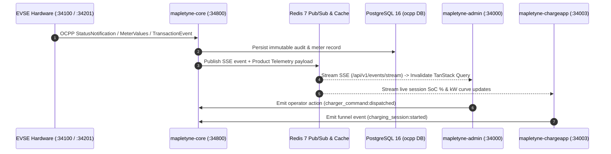

<!--
<agent-discovery-protocol>
ROLE: Product Manager (John - bmm-pm)
CO-PILOT: Business Analyst (Mary - bmm-analyst)
PHASE: Phase 1 (Product Strategy & Telemetry Hygiene)

MANDATORY USER INTERVIEW CHECKLIST:
1. "What 3 to 5 core funnel conversion events define user activation and revenue recognition in this app?"
2. "What analytics destination will you use (PostHog, Mixpanel, RudderStack, Segment, Custom DB)?"
3. "What user identifiers will you use (anonymous ID vs. authenticated UUID)?"
4. "Are there any sensitive user data attributes that must be explicitly masked from telemetry payloads?"

PRE-FLIGHT INSPECTION:
- Review existing telemetry packages in `package.json`.
- Check if `COOKIE_POLICY.md` exists; client telemetry must remain dormant until consent is granted.

INVARIANT: Event names MUST follow strict lowercase snake_case `object:action_past_tense` syntax. NEVER pass raw PII (credit cards, passwords, SSNs, street addresses) to telemetry payloads.
</agent-discovery-protocol>
-->

# Telemetry, Product Analytics & Event Tracking: Mapletyne MTT Charge CPO Platform

## 1. Event Taxonomy & Architecture Conventions
- **Naming Syntax:** Strictly lowercase `object:action_past_tense` (with `snake_case` segments).
- **Analytics & Telemetry Destinations:**
  1. **Internal Real-Time Operational Bus:** `mapletyne-core` (`:34800`) persists structured operational and audit events to PostgreSQL (`ocpp.events` / `ocpp.audit_log`) and fans out real-time state transitions over Redis Pub/Sub to Server-Sent Events (`GET /api/v1/events/stream`).
  2. **Product Analytics Pipeline:** Self-hosted PostHog / RudderStack-compatible JSON event ingestion (`POST /api/v1/events/telemetry`) and outbound HMAC-signed webhook relays (`POST /api/v1/events/webhooks`).
- **Identity Resolution:**
  - **Authenticated Users:** Resolved via Keycloak 26 `sub` UUID (`usr_<uuid>`) and mapped `realm_access.roles` (`cpo-admin`, `site-operator`, `billing-manager`, `fleet-manager`, `driver`).
  - **Ad-Hoc Guest Drivers:** Tracked via ephemeral session-scoped anonymous UUID (`anon_<uuid>`) rotated upon session completion.
- **Standard Event Envelope Schema:**
  ```json
  {
    "event": "charging_session:started",
    "properties": {
      "app_surface": "mapletyne-chargeapp",
      "app_version": "1.0.0",
      "user_id": "usr_7f9c2a10-6919-8015-8008-d26610b454c5",
      "org_id": "org_mapletyne_cpo",
      "role": "driver",
      "site_id": "SITE-LON-CENTRAL-01",
      "cp_id": "CP-LON-001",
      "connector_id": 1,
      "ocpp_protocol": "2.0.1",
      "route": "/app/session/ses_99481",
      "timestamp": "2026-10-21T17:40:00Z"
    }
  }
  ```

## 2. Dual-Channel Telemetry Architecture (Mermaid.js)


## 3. Core Funnel, Operational & Revenue Event Registry

### 3.1 Identity & Onboarding Funnel (`Keycloak 26` + `AD-11` / `AD-12`)
| Event Name | Trigger Source | Payload Properties | Business & Operational Significance |
| :--- | :--- | :--- | :--- |
| `registration_otp:requested` | `POST /api/v1/public/account/register/init` | `requested_role`, `channel` (`smtp`), `ttl_seconds` (`600`) | Top-of-funnel self-registration initiation (`AD-12`). |
| `user:registered` | `POST /api/v1/public/account/register/verify` | `user_id`, `role`, `verification_attempts`, `auto_login_success` | Verified account creation in Keycloak 26 with `emailVerified: true`. |
| `user:authenticated` | `POST /api/v1/admin/auth/login` | `user_id`, `role`, `grant_type` (`password` / `refresh_token`), `app_surface` | Session activation across Operator Mission Control or Driver PWA (`AD-11`). |

### 3.2 Driver Mobile PWA Activation & Revenue Funnel (`mapletyne-chargeapp` `:34003`)
| Event Name | Trigger Source | Payload Properties | Business & Operational Significance |
| :--- | :--- | :--- | :--- |
| `station:selected` | Driver PWA Map / QR Scanner | `cp_id`, `site_id`, `discovery_method` (`map_pin` \| `qr_scan` \| `search`), `available_connectors` | Measures station discovery conversion and QR decal effectiveness. |
| `tariff_estimate:calculated` | Pre-Charge Estimator Sheet | `cp_id`, `connector_id`, `selected_kwh_pill` (`10` \| `25` \| `50` \| `full`), `estimated_cost`, `currency` | Tracks driver price sensitivity prior to session authorization. |
| `charging_session:started` | `POST /api/v1/chargers/{cp_id}/start` | `session_id`, `cp_id`, `connector_id`, `auth_mode` (`jwt_wallet` \| `rfid` \| `iso15118_pnc` \| `guest_qr`) | Core driver activation metric; correlates OCPP `RemoteStartTransaction` / `TransactionEvent(Started)`. |
| `charging_session:completed` | OCPP `StopTransaction` / `TransactionEvent(Ended)` | `session_id`, `cp_id`, `site_id`, `kwh_delivered`, `duration_seconds`, `gross_amount`, `currency`, `stop_reason` | Primary CPO gross revenue recognition and charger utilization metric. |
| `cdr_receipt:downloaded` | `GET /api/v1/sessions/{session_id}/receipt.pdf` | `session_id`, `org_id`, `currency`, `tax_included` (`true`) | Verifies regulatory AFIR/VAT receipt delivery (`AD-10`). |

### 3.3 Operator Mission Control, Self-Healing & Financial Intelligence (`mapletyne-admin` `:34000`)
| Event Name | Trigger Source | Payload Properties | Business & Operational Significance |
| :--- | :--- | :--- | :--- |
| `charger_command:dispatched` | Operator Charger Detail Drawer | `cp_id`, `command` (`remote_start` \| `remote_stop` \| `soft_reset` \| `unlock_connector` \| `set_charging_profile`), `optimistic_latency_ms` | Tracks operator intervention frequency and verifies `<250ms` optimistic UI SLA (`AD-8`). |
| `self_healing:triggered` | `mapletyne-core` Self-Healing Engine | `cp_id`, `connector_id`, `ocpp_error_code`, `phase_reached` (`1_verify` .. `5_webhook`), `recovered` (`boolean`), `recovery_seconds` | Quantifies automated fault recovery and prevented field technician truck rolls. |
| `tariff_simulation:executed` | "What-If" Dynamic Tariff Simulator | `site_id`, `spot_multiplier`, `margin_per_kwh`, `replayed_sessions_count`, `projected_margin_delta_pct` | Measures adoption of predictive ENTSO-E dynamic tariff modeling. |
| `tariff_config:published` | `PUT /api/v1/pricing/config` | `tariff_id`, `pricing_mode` (`static` \| `entsoe_dynamic`), `base_currency` | Audit trail for production tariff mutations. |
| `host_payout:generated` | Site Host Revenue Split Engine | `site_id`, `period_start`, `period_end`, `gross_revenue`, `energy_cost`, `ocpi_commission`, `host_split_pct`, `net_payout` | Financial audit record for multi-tenant property partner settlements. |
| `branding_theme:updated` | `PUT /api/v1/settings/branding` | `org_id`, `primary_color`, `accent_color`, `theme_mode` | Tracks white-label studio updates and `:root` CSS Custom Property propagation (`AD-7`, `AD-9`). |
| `pki_certificate:signed` | `POST /api/v1/pki/sign-csr` | `cert_type` (`secc_leaf` \| `cpo_sub_ca` \| `emaid`), `cp_id`, `validity_days` | Cryptographic security audit trail for ISO 15118-20 Plug & Charge. |
| `ems_curtailment:applied` | `POST /api/v1/ems/curtailment` | `site_id`, `grid_limit_kw`, `solar_kw`, `bess_kw`, `ev_load_kw`, `throttled_chargers_count` | Tracks grid peak shaving and site transformer protection events. |

## 4. Anti-Tracking, Privacy Defense & PII Boundaries
- **Strictly Banned in Telemetry Payloads:**
  - Plaintext or hashed passwords, Keycloak client secrets, RS256 Bearer JWT strings, `X-API-Key` values, and 6-digit registration OTP codes.
  - Payment card Primary Account Numbers (PANs), CVVs, IBAN/SEPA bank account numbers, and Stripe payment method tokens.
  - Driver full legal names, raw email addresses, phone numbers, home street addresses, and exact smartphone GPS coordinates (only station `site_id`, `cp_id`, and coarse geohash/city are permitted).
  - ISO 15118 private cryptographic keys (`.pem` / `.key` material).
- **Consent Gate & Storage Hygiene:**
  - Client-side analytical trackers in `mapletyne-admin` and `mapletyne-chargeapp` remain dormant until the user grants analytics consent per `docs/legal/COOKIE_POLICY.md`.
  - Operational OCPP state events (`StatusNotification`, `MeterValues`, `self_healing:triggered`) required for hardware safety and billing accuracy execute server-side in `mapletyne-core` without third-party cookie tracking.
