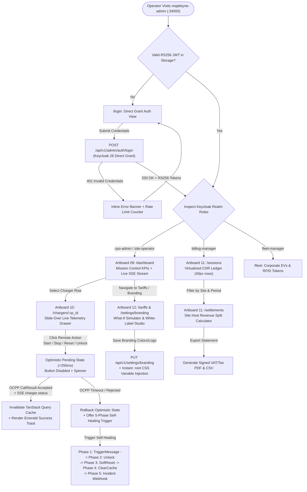

<!--
<agent-discovery-protocol>
ROLE: UX Designer (Sally - bmm-ux-designer)
CO-PILOT: Product Manager (John - bmm-pm)
PHASE: Phase 1 (App Flow & Navigation State Machine)

MANDATORY USER INTERVIEW CHECKLIST:
1. "What is the entry point for this feature (e.g. email magic link, dashboard card, direct public URL)?"
2. "What are the intermediate loading and waiting states (e.g. async progress bar, skeleton screen)?"
3. "What happens when an error occurs—does the user stay on the same screen or redirect to an error view?"
4. "Where does the user land immediately after completing the action?"

PRE-FLIGHT INSPECTION:
- Check existing routing structure in `src/pages`, `src/app`, or `src/routes`.
- Ensure all public vs. authenticated route boundaries are mapped.

INVARIANT: Mermaid diagrams must be valid syntax. All branching conditions must account for success, validation failure, and server error paths.
</agent-discovery-protocol>
-->

# Application Flow & Screen Transition State Machines

## 1. Visual SSOT & Penpot Artboard Registry (12 Verified Artboards)
All screen transitions in the Mapletyne MTT Charge CPO Enterprise platform map directly to the verified Penpot Design System SSOT (**99.8% `penpot-verify` composite score**, `561 layers`, `revn = 1838`):
- **Penpot Project ID:** `b0861d9d-6919-8015-8008-d26610b454c5`
- **Penpot File ID:** `b0861d9d-6919-8015-8008-d266309e53fd`
- **Penpot Page ID:** `b0861d9d-6919-8015-8008-d266309e53fe`
- **Workspace URL:** `http://localhost:15050/#/workspace?project-id=b0861d9d-6919-8015-8008-d26610b454c5&file-id=b0861d9d-6919-8015-8008-d266309e53fd&page-id=b0861d9d-6919-8015-8008-d266309e53fe`
- **Brand & Ergonomic Invariants:** Forest Emerald M3 (`#006948` seed, `#10B981` / `#48E260` highlights), Dual-Adaptive theme (`#F8FAFC` Light-Mode default for Operator Mission Control on port `34000`; `#0B0F19` Dark-Mode-First for Driver Mobile PWA on port `34003`), exclusively `material-symbols-outlined` icons, $\ge 12\text{px}$ typography floor, and $\ge 44\times 44\text{px}$ touch targets.

| Artboard # | Portal | Viewport | Screen / Artboard Name | Primary Route |
| :--- | :--- | :--- | :--- | :--- |
| **Artboard 01** | `mapletyne-chargeapp` (Driver PWA) | `390x844` | **Driver Onboarding & 2-Step OTP Auth** | `/app/login`, `/app/register` |
| **Artboard 02** | `mapletyne-chargeapp` (Driver PWA) | `390x844` | **Station Discovery Map & Filter Sheet** | `/app/map` |
| **Artboard 03** | `mapletyne-chargeapp` (Driver PWA) | `390x844` | **Station Detail & Connector Selection** | `/app/station/:cp_id` |
| **Artboard 04** | `mapletyne-chargeapp` (Driver PWA) | `390x844` | **Pre-Charge Cost & kWh Estimator (`+10/+25/+50 kWh`)** | `/app/station/:cp_id/estimate` |
| **Artboard 05** | `mapletyne-chargeapp` (Driver PWA) | `390x844` | **QR Scanner & Ad-Hoc Guest Authorization** | `/app/scan` |
| **Artboard 06** | `mapletyne-chargeapp` (Driver PWA) | `390x844` | **Live Active Charging Session (SoC Ring & kW Curve)** | `/app/session/:session_id` |
| **Artboard 07** | `mapletyne-chargeapp` (Driver PWA) | `390x844` | **Post-Charge VAT Receipt & CDR Summary** | `/app/receipt/:session_id` |
| **Artboard 08** | `mapletyne-chargeapp` (Driver PWA) | `390x844` | **Driver Wallet, RFID Vault & Charging History** | `/app/wallet`, `/app/history` |
| **Artboard 09** | `mapletyne-admin` (Operator SPA) | `1440x900` | **Operator Mission Control Overview & EMS Load Gauges** | `/dashboard`, `/ems` |
| **Artboard 10** | `mapletyne-admin` (Operator SPA) | `1440x900` | **Charger Inventory, Live Drawer & Self-Healing Monitor** | `/chargers`, `/chargers/:cp_id` |
| **Artboard 11** | `mapletyne-admin` (Operator SPA) | `1440x900` | **Virtualized CDR Ledger & Site Host Revenue Splits** | `/sessions`, `/settlements` |
| **Artboard 12** | `mapletyne-admin` (Operator SPA) | `1440x900` | **Dynamic Tariff Simulator, PKI Vault & Brand Studio** | `/tariffs`, `/pki`, `/settings/branding` |

---

## 2. Operator Mission Control State Machine (`mapletyne-admin` `:34000`)


---

## 3. Driver Mobile PWA State Machine (`mapletyne-chargeapp` `:34003`)
```mermaid
flowchart TD
    D_START(["Driver Opens mapletyne-chargeapp (:34003)\nDark-Mode-First (#0B0F19)"]) --> ENTRY_MODE{"Entry Method?"}
    ENTRY_MODE -->|Map Browse| MAP_VIEW["Artboard 02: /app/map\nDark Vector Map + Live Availability Pins"]
    ENTRY_MODE -->|QR Scan on EVSE| QR_SCAN["Artboard 05: /app/scan\nCamera QR / Station ID Lookup"]
    ENTRY_MODE -->|Account Sign-In| D_AUTH["Artboard 01: /app/login & /app/register\n2-Step Email OTP (600s Redis TTL)"]

    D_AUTH -->|OTP Verified| D_TOKEN["Keycloak 26 Auto-Login\n(driver RS256 JWT Issued)"]
    D_TOKEN --> MAP_VIEW

    MAP_VIEW -->|Tap Station Marker| STATION_SHEET["Artboard 03: /app/station/:cp_id\nSwipeable Bottom Sheet + Connector Status"]
    QR_SCAN -->|Valid CP_ID + Connector| STATION_SHEET

    STATION_SHEET -->|Select Available Connector| ESTIMATOR["Artboard 04: /app/station/:cp_id/estimate\n+10 / +25 / +50 kWh Pill Picker + Tariff Disclosure"]
    ESTIMATOR -->|Tap Start Charge (>=44x44px)| AUTH_GATE{"Authenticated or Ad-Hoc Guest?"}
    AUTH_GATE -->|No Payment / Auth| WALLET_MODAL["Artboard 08: /app/wallet\nStripe PaymentIntent / RFID Link"]
    WALLET_MODAL -->|Authorized| START_CMD["POST /api/v1/chargers/:cp_id/start\n(OCPP RemoteStartTransaction)"]
    AUTH_GATE -->|Authorized| START_CMD

    START_CMD -->|EVSE Plugged & Accepted| LIVE_SESSION["Artboard 06: /app/session/:session_id\nLive SoC Ring (%) + kW Curve + Cost Counter"]
    START_CMD -->|Cable Unplugged / Timeout| START_ERR["Error Sheet: Check Connector Cable\n+ Retry or Unlock Connector"]
    START_ERR --> STATION_SHEET

    LIVE_SESSION -->|Slide to Stop / Full SoC| STOP_CMD["POST /api/v1/chargers/:cp_id/stop\n(OCPP RemoteStopTransaction)"]
    STOP_CMD -->|CDR Finalized| RECEIPT["Artboard 07: /app/receipt/:session_id\nItemized VAT/Tax Breakdown + 1-Click PDF Receipt"]
    RECEIPT -->|View Past Sessions| HISTORY["Artboard 08: /app/history\nChronological Session Log & Spend Chart"]
```

---

## 4. Comprehensive Route, Access Gate & View Mapping Table
| Service / Portal | Route Pattern | View / Component Name | Access Gate (Keycloak RBAC) | Permitted Actions & State Transitions |
| :--- | :--- | :--- | :--- | :--- |
| `mapletyne-admin` (`:34000`) | `/login`, `/register` | Operator Auth & 2-Step OTP Onboarding | Public | Authenticate via Keycloak Direct Grant (`POST /api/v1/admin/auth/login`) or verify 6-digit Redis OTP (`AD-11`, `AD-12`). |
| `mapletyne-admin` (`:34000`) | `/dashboard` | Mission Control Overview (Artboard 09) | `cpo-admin`, `site-operator`, `billing-manager`, `fleet-manager` | View real-time network uptime, active kW throughput, revenue KPIs, and live SSE event feed (`/api/v1/events/stream`). |
| `mapletyne-admin` (`:34000`) | `/chargers`, `/chargers/:cp_id` | Hardware Inventory & Live Detail Drawer (Artboard 10) | `cpo-admin`, `site-operator` | Provision EVSEs, inspect connector telemetry, dispatch optimistic remote OCPP commands (`<250ms`), monitor 5-phase self-healing. |
| `mapletyne-admin` (`:34000`) | `/sessions` | Virtualized Sessions & CDR Ledger (Artboard 11) | `cpo-admin`, `site-operator`, `billing-manager` | Scroll 100,000+ CDR rows at 60 FPS (`40px` fixed height via `@tanstack/react-virtual`), filter by site/date, export CSV/PDF. |
| `mapletyne-admin` (`:34000`) | `/settlements` | Site Host Revenue Split & Payout Engine (Artboard 11) | `cpo-admin`, `billing-manager` | Calculate `(Gross Revenue - Energy Cost - OCPI Commission) * Host Split %` and generate monthly host payout PDF statements. |
| `mapletyne-admin` (`:34000`) | `/tariffs` | Dynamic Tariff Builder & "What-If" Simulator (Artboard 12) | `cpo-admin`, `billing-manager` | Replay historical 15-min meter curves against ENTSO-E spot multipliers and 1-click publish to `PUT /api/v1/pricing/config`. |
| `mapletyne-admin` (`:34000`) | `/fleet`, `/tokens` | Corporate Fleet EVs & RFID Token Vault | `cpo-admin`, `fleet-manager` | Provision/block RFID `id_tag` tokens, assign driver groups, and configure ISO 15118 EMAID contract certificates. |
| `mapletyne-admin` (`:34000`) | `/ems` | Site Energy Management & Load Balancing (Artboard 09) | `cpo-admin`, `site-operator` | Monitor real-time Grid vs. Solar vs. BESS vs. EV load gauges and dispatch OCPP `SetChargingProfile` curtailment limits. |
| `mapletyne-admin` (`:34000`) | `/pki` | ISO 15118-20 Cryptographic PKI Vault (Artboard 12) | `cpo-admin` | Inspect V2G Root CA / CPO Sub-CA hierarchy, sign SECC Leaf CSRs, and revoke compromised certificates via OCSP. |
| `mapletyne-admin` (`:34000`) | `/settings/branding` | White-Label Brand Studio & Legal Entity (Artboard 12) | `cpo-admin` | Update logos, M3 color tokens, and legal VAT authority (`AD-10`); dynamically inject `:root` CSS variables (`AD-7`, `AD-9`). |
| `mapletyne-chargeapp` (`:34003`) | `/app/map`, `/app/station/:cp_id` | Driver Map Discovery & Estimator Sheet (Artboards 02–04) | Public / `driver` | Discover stations on dark vector map, inspect live connector availability/tariffs, run `+10/+25/+50 kWh` pre-charge estimator. |
| `mapletyne-chargeapp` (`:34003`) | `/app/scan` | Instant QR Scanner & Station Lookup (Artboard 05) | Public / `driver` | Scan physical EVSE QR decal or enter `cp_id` for ad-hoc guest or authenticated session start. |
| `mapletyne-chargeapp` (`:34003`) | `/app/session/:session_id` | Live Active Session Telemetry (Artboard 06) | `driver` / Signed Guest Session Token | Track real-time SoC % ring, live kW & Voltage ECharts curve, accrued cost, and execute slide-to-stop command. |
| `mapletyne-chargeapp` (`:34003`) | `/app/receipt/:session_id`, `/app/wallet`, `/app/history` | VAT Receipt, Driver Wallet & Session History (Artboards 07–08) | `driver` | Download itemized VAT PDF receipts, manage saved payment methods/RFID cards, and audit monthly charging spend. |
| `mapletyne-core` (`:34800`) | `/api/v1/*`, `/api/v1/events/stream` | OpenAPI 3.0 REST & SSE Stream Gateway | RS256 Bearer JWT / `X-API-Key` / HMAC Signature | Serve 147 typed REST endpoints, broadcast Redis Pub/Sub SSE invalidation events, and process HMAC-signed webhooks. |
| `mapletyne-core` (`:34100` / `:34201`) | `/ocpp16/:cp_id`, `/ocpp201/:cp_id` | OCPP 1.6-J & 2.0.1 WebSocket Listeners | Basic Auth / TLS Client Certificate (ISO 15118) | Bidirectional JSON-over-WebSocket framing for EVSE hardware telemetry, smart charging, and remote orchestration. |
