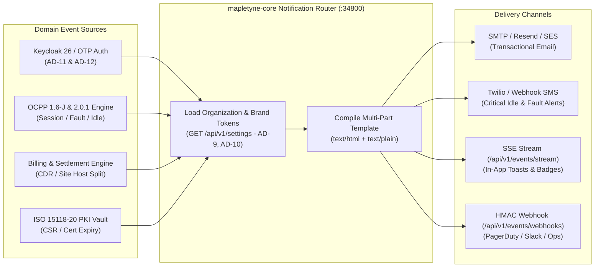

<!--
<agent-discovery-protocol>
ROLE: Product Manager (John - bmm-pm)
CO-PILOT: Core Developer (Amelia - bmm-dev)
PHASE: Phase 1 (Product Strategy & Transactional Communications)

MANDATORY USER INTERVIEW CHECKLIST:
1. "Which user actions require immediate email/SMS notifications versus in-app alerts?"
2. "What email delivery provider will be used (Resend, SendGrid, Postmark, AWS SES)?"
3. "What company legal physical address must be injected into the footer for CAN-SPAM / CASL compliance?"
4. "What is the unsubscribe policy—can users opt out of transactional security alerts, or only marketing/digest emails?"

PRE-FLIGHT INSPECTION:
- Check `package.json` for React Email (`@react-email/components`) or MJML dependencies.
- Verify environment variables for `RESEND_API_KEY` or equivalent in `backend/ENV_SPEC.md`.

INVARIANT: Never write raw HTML table templates inline in controllers. Always provide both `text/html` and auto-compiled `text/plain` alternatives.
</agent-discovery-protocol>
-->

# Email, SMS & In-App Notification Specifications: Mapletyne MTT Charge CPO Platform

## 1. Email & Notification Rendering Standards
- **Template Engine & Styling Architecture:**
  - All transactional emails are compiled from dedicated, dark-branded MJML / Jinja2 / React Email templates stored under `templates/emails/` and dispatched asynchronously by `mapletyne-core` (`:34800`) via the configured SMTP / Resend / AWS SES transport stored in `ocpp.settings` (`smtp` record, per `AD-12`).
  - Templates inherit the tenant's dynamic White-Label Branding & Organization Authority settings (`GET /api/v1/settings` — `company_name`, `logo_url`, `primary_color` default `#006948`, `accent_color` default `#10B981`, `support_email`, `support_phone`) and never hardcode inline HTML tables inside FastAPI route controllers.
- **Mandatory Legal & Regulatory Footers (`AD-10`, CAN-SPAM, CASL, GDPR, AFIR):**
  - **Legal Authority Block:** Dynamically injected from the `organization` setting profile (`AD-10`):
    - Registered Entity: `Mapletyne Energy Infrastructure Ltd. (t/a Mapletyne MTT Charge)`
    - Physical Address: `100 Bishopsgate, Level 18, London EC2N 4AG, United Kingdom` (or tenant-configured `organization.registered_address`)
    - Tax / VAT & Registration ID: `GB-VAT-482910492` / `Company Reg No. 14982011`
  - **One-Click Unsubscribe & Notification Preferences (`RFC 8058`):**
    - Header & Footer Link: `https://opencpo.mapletyne.com/app/settings/notifications?unsubscribe_token=<signed_jwt_token>`
    - **Unsubscribe Policy:** Users can opt out of operational digests, marketing announcements, and non-critical alerts with one click. Critical security events (2-Step Registration OTP codes, password resets, PKI certificate compromises) and legally mandated financial records (VAT CDR charging receipts and Site Host payout statements) are strictly transactional and bypass marketing opt-outs.
- **Multi-Part MIME Delivery:** Every outbound email MUST include both `text/html` (Forest Emerald `#006948` / Dark Canvas `#0B0F19` styled) and an automatically generated `text/plain` fallback.

---

## 2. Multi-Channel Notification Dispatch Architecture (Mermaid.js)

---

## 3. Transactional & Operational Notification Matrix
| Notification Event | Channel(s) | Trigger Source & Condition | Template Path | Priority & SLA | Opt-Out Permitted? |
| :--- | :--- | :--- | :--- | :--- | :--- |
| **1. Two-Step Registration 6-Digit OTP (`AD-12`)** | Email (`SMTP`) | `POST /api/v1/public/account/register/init` (or Admin Register); stored in Redis with `600s` TTL and 5-attempt cap | `templates/emails/auth-otp-verification.html` | **Critical** (`< 3s` dispatch) | No (Transactional Security) |
| **2. Account Provisioned & Role Assigned (`AD-11`)** | Email + In-App | Successful 6-digit OTP verification and Keycloak 26 realm role assignment (`driver`, `site-operator`, `fleet-manager`, `cpo-admin`) | `templates/emails/welcome-provisioned.html` | **High** (`< 10s`) | No (Transactional Onboarding) |
| **3. Security Alert & Password / Token Reset** | Email + SMS | New unrecognized IP login, Keycloak credential reset, or API key rotation | `templates/emails/security-alert.html` | **Critical** (`< 5s`) | No (Transactional Security) |
| **4. Live Session Complete & Itemized VAT CDR Receipt (`AD-10`)** | Email + In-App (`mapletyne-chargeapp`) | OCPP `StopTransaction` / `TransactionEvent(Ended)` finalized with kWh, idle fee, and VAT calculation | `templates/emails/driver-cdr-receipt.html` | **High** (`< 15s` with PDF attachment) | No (Regulatory Financial Receipt) |
| **5. EV Charge Complete & Idle Fee Grace Warning** | SMS + In-App Push / Banner | EVSE transitions to `SuspendedEV` / `Finishing` (100% SoC reached); warns driver 5 mins before `€/min` idle fee begins | `templates/notifications/idle-fee-warning.txt` | **Critical** (`< 5s`) | Yes (SMS toggle in `/app/profile`) |
| **6. Self-Healing Phase 5 Unrecoverable Fault Escalation** | Email + SMS + HMAC Webhook + In-App SSE | 5-Phase Self-Healing Engine (`TriggerMessage` $\rightarrow$ `UnlockConnector` $\rightarrow$ `SoftReset` $\rightarrow$ `ClearCache`) fails after 180s on `Faulted` EVSE | `templates/emails/ops-fault-escalation.html` | **Critical** (`Immediate`) | No (NOC Hardware Safety) |
| **7. Monthly Site Host Revenue Split & Payout Statement** | Email (with PDF + CSV) | Billing Manager executes monthly settlement run (`POST /api/v1/settlements/generate`) for property host (`site_id`) | `templates/emails/site-host-payout-statement.html` | **Medium** (Batch / Scheduled) | No (Contractual Financial Settlement) |
| **8. ISO 15118-20 PKI Certificate Expiry / Revocation Alert** | Email + In-App Banner | V2G Sub-CA or SECC Leaf Certificate within `14 days` of expiration or revoked via OCSP | `templates/emails/pki-cert-lifecycle-alert.html` | **High** (Daily Check) | No (Cryptographic Infrastructure) |
| **9. EMS Site Transformer Peak Shaving Alert** | In-App SSE Toast + Email Digest | Site load reaches `>90%` of grid import limit, triggering automated `SetChargingProfile` curtailment | `templates/emails/ems-curtailment-digest.html` | **Medium** (`< 30s` SSE / Daily Email) | Yes (Email digest configurable) |
| **10. Weekly Fleet & Depot Utilization Digest** | Email | Sunday `06:00 UTC` scheduled report for `fleet-manager` and `cpo-admin` personas | `templates/emails/weekly-depot-digest.html` | **Low** (Weekly Cron) | Yes (One-click unsubscribe) |
