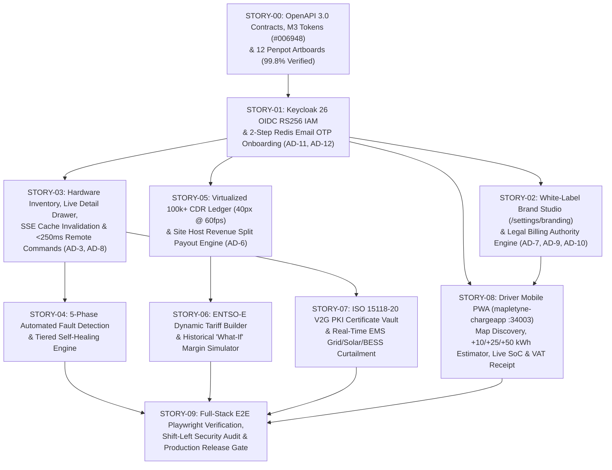

# Sprint Implementation Plan & Vertical Story DAG: Mapletyne MTT Charge CPO Platform

## 1. Sprint Objective & Governance Target
- **Sprint ID:** `SPRINT-01` (Mapletyne MTT Charge CPO Enterprise Platform — Core CSMS, Operator Mission Control & Driver Mobile PWA)
- **Sprint Goal:** Deliver a production-verified, multi-tenant Charge Point Operator (CPO) enterprise platform uniting `mapletyne-core` (Python 3.12+ FastAPI / OCPP 1.6-J `:34100` & OCPP 2.0.1 / ISO 15118-20 `:34201` / REST & SSE `:34800`), `mapletyne-admin` (`:34000` React 18 + TypeScript + Vite + Tailwind CSS + TanStack Query/Virtual Operator Mission Control), and `mapletyne-chargeapp` (`:34003` FastAPI + Jinja2 + HTMX Dark-Mode-First Driver Mobile PWA) governed by Keycloak 26 OIDC/RS256 IAM and the verified 12-Artboard Penpot Forest Emerald M3 Design System (`#006948` seed, `99.8%` `penpot-verify` score, `revn = 1838`).
- **Target Deliverable:** End-to-end vertical feature slices meeting all Gherkin acceptance criteria in `docs/product/PRD.md`, strict architectural invariants (`AD-1` through `AD-12` in `docs/ARCHITECTURE-SPINE.md`), and 3-Way QA Gate verification.

---

## 2. Vertical Story Dependency Graph (Mermaid.js)

---

## 3. Vertical Story Execution Ledger
| Story ID | Vertical Slice Title & Scope | Target Services & Ports | Penpot Artboard Mapping | Depends On | Parallelizable? | Status |
| :--- | :--- | :--- | :--- | :--- | :--- | :--- |
| **STORY-00** | **M3 Design Tokens, OpenAPI Contracts & Penpot 12-Artboard Verification:** Generate Forest Emerald (`#006948`) M3 tokens, compile `/openapi.json` via `openapi-typescript`, and verify 12 Penpot artboards (561 layers, `revn = 1838`, 99.8% score). | `penpot` (`:15050`), `mapletyne-admin` (`:34000`), `mapletyne-chargeapp` (`:34003`) | Artboards 01–12 | None | No | **Done** |
| **STORY-01** | **Keycloak 26 Unified IAM & 2-Step Redis OTP Registration (`US-001`):** Provision `opencpo` realm, RS256 JWKS validation in `mapletyne-core`, Direct Grant login, and 6-digit SMTP OTP onboarding (`600s` Redis TTL, 5-attempt cap, RBAC guards). | `keycloak` (`:34080`), `mapletyne-core` (`:34800`), `mapletyne-admin` (`:34000`), `mapletyne-chargeapp` (`:34003`) | Artboard 01, Login Views | `STORY-00` | No | **Active** |
| **STORY-02** | **White-Label Brand Studio & Legal Tax Authority (`US-007`):** Wire `/settings/branding` and `organization` profile (`AD-10`) to `PUT /api/v1/settings/{key}`, dynamically injecting `:root` CSS Custom Properties and `/skin/*` PWA assets without rebuilds. | `mapletyne-core` (`:34800`), `mapletyne-admin` (`:34000`), `mapletyne-chargeapp` (`:34003`) | Artboard 12 | `STORY-01` | Yes | **Pending** |
| **STORY-03** | **Real-Time Charger Inventory, SSE Stream & Optimistic Commands (`US-002`):** Implement `useLiveEvents` (`GET /api/v1/events/stream`) invalidating TanStack Query caches and slide-over Charger Detail Drawer with `<250ms` optimistic `RemoteStart`/`RemoteStop`/`SoftReset`/`UnlockConnector`. | `mapletyne-core` (`:34800`, `:34100`, `:34201`), `mapletyne-admin` (`:34000`) | Artboards 09, 10 | `STORY-01` | Yes | **Pending** |
| **STORY-04** | **5-Phase Automated Fault Detection & Self-Healing Engine (`US-003`):** Automate remediation pipeline on `Faulted` / non-zero `errorCode` (`TriggerMessage` $\rightarrow$ `UnlockConnector` $\rightarrow$ `Reset(Soft)` $\rightarrow$ `ClearCache` $\rightarrow$ Incident Webhook & SMS/Email alert). | `mapletyne-core` (`:34800`, `:34100`, `:34201`), `mapletyne-admin` (`:34000`) | Artboard 10 | `STORY-03` | Yes | **Pending** |
| **STORY-05** | **Virtualized CDR Billing Ledger & Site Host Revenue Splits (`US-004`):** Render 100,000+ CDRs at 60 FPS using `@tanstack/react-virtual` (`40px` rows) and build the Site Host Revenue Split calculator with signed VAT PDF/CSV payout statements. | `mapletyne-core` (`:34800`), `mapletyne-admin` (`:34000`) | Artboard 11 | `STORY-01` | Yes | **Pending** |
| **STORY-06** | **ENTSO-E Dynamic Tariff Builder & "What-If" Simulator (`US-005`):** Replay 15-minute historical `MeterValues` against Day-Ahead spot price formulas (`SpotPrice * Multiplier + MarginPerKwh`) with comparative margin charts and 1-click publish. | `mapletyne-core` (`:34800`), `mapletyne-admin` (`:34000`) | Artboard 12 | `STORY-05` | Yes | **Pending** |
| **STORY-07** | **ISO 15118-20 PKI Vault & EMS Site Load Balancing (`US-008`):** Build V2G Root/Sub-CA trust tree, SECC Leaf CSR signer, OCSP status monitor, and real-time Grid/Solar/Battery/EV circular load gauges with `SetChargingProfile` curtailment. | `mapletyne-core` (`:34800`, `:34201`), `mapletyne-admin` (`:34000`) | Artboards 09, 12 | `STORY-03` | Yes | **Pending** |
| **STORY-08** | **Driver Mobile PWA End-to-End Charging Flow (`US-006`):** Implement Dark-Mode-First (`#0B0F19`) station discovery map, QR scanner, `+10/+25/+50 kWh` pre-charge estimator, live SoC % ring & ECharts kW curve, slide-to-stop, wallet/RFID vault, and 1-click VAT PDF receipt. | `mapletyne-chargeapp` (`:34003`), `mapletyne-core` (`:34800`) | Artboards 01–08 | `STORY-01`, `STORY-02` | Yes | **Pending** |
| **STORY-09** | **3-Way Quality Gate (Functional E2E, Visual Parity & Shift-Left Security):** Execute automated API + Playwright E2E test suites across desktop (`1440x900`) and mobile (`390x844`) viewports, verify zero `any` types, and validate OWASP/RBAC/PII security gates. | All Services (`:34000`, `:34003`, `:34800`, `:34100`, `:34201`, `:34080`) | Artboards 01–12 | `STORY-04`, `STORY-06`, `STORY-07`, `STORY-08` | No | **Pending** |

---

## 4. Definition of Done (DoD) & 3-Way Quality Gate Criteria
1. **Functional & Protocol Completeness:**
   - All REST calls in `mapletyne-admin` bind strictly to `src/lib/types/api.ts` generated from `/openapi.json` (`AD-2`) with zero `any` casts.
   - Real-time charger telemetry updates via `/api/v1/events/stream` SSE invalidation (`AD-3`) with `<250ms` optimistic mutation feedback (`AD-8`).
   - Virtualized tables (`Sessions`, `MeterValues`, `Events`) lock row height at `40px` (`AD-6`) and sustain `60 FPS` scrolling under 100,000+ records.
2. **Design System & Visual Parity Gate (`Sally` / Penpot SSOT):**
   - 100% adherence to Forest Emerald M3 tokens (`#006948` seed, `#10B981` / `#48E260` semantic highlights), `#F8FAFC` Light-Mode default on `mapletyne-admin` (`:34000`), and `#0B0F19` Dark-Mode-First canvas on `mapletyne-chargeapp` (`:34003`).
   - Exclusively Google Material Symbols (`material-symbols-outlined`); zero Lucide, FontAwesome, Feather, or Heroicons imports.
   - Typography floor $\ge 12\text{px}$ (`text-xs`) and interactive touch targets $\ge 44\times 44\text{px}$ across all 12 Penpot artboards.
3. **Security & Compliance Gate (`Winston` & `Murat`):**
   - Keycloak 26 RS256 JWT verification enforced on all protected routes (`AD-11`); 2-step email OTP stored in Redis with strict `600s` TTL and 5-attempt lockout (`AD-12`).
   - Zero PII leakage in product telemetry payloads (`docs/product/ANALYTICS_AND_TRACKING.md`) and full VAT/Tax legal entity attribution on all generated CDR invoices and host payout statements (`AD-10`).
