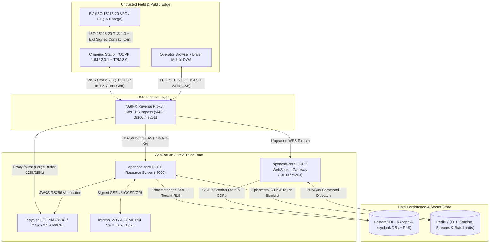
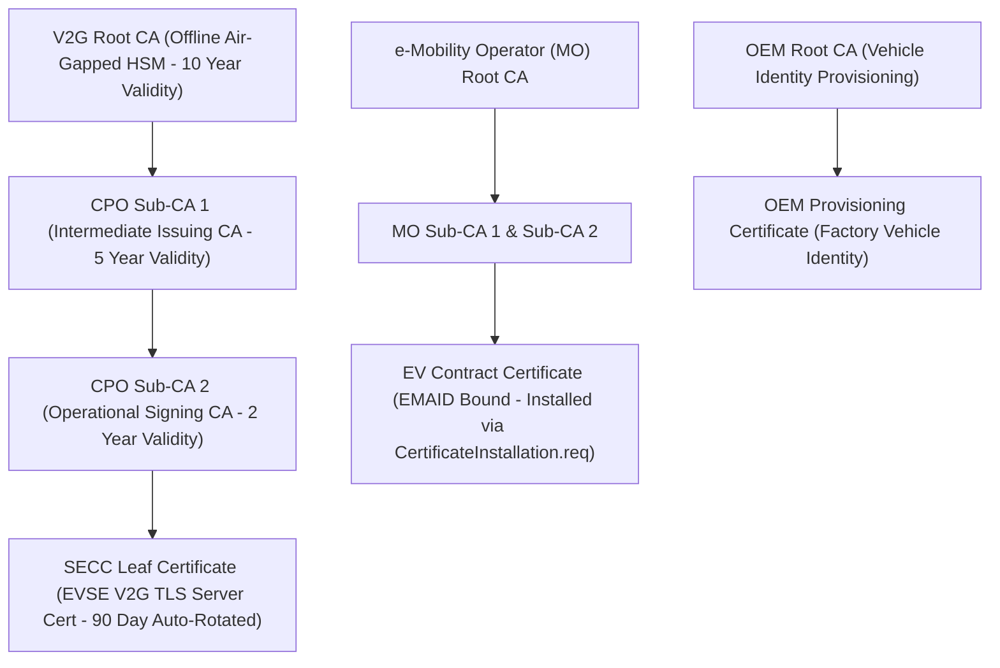

# Enterprise Security Policy, Threat Model & Cryptographic Architecture

```yaml
title: Mapletyne MTT Charge CPO Enterprise Security Policy & Threat Model
version: "2.0.0"
date: "2026-10-21"
status: approved
author: Murat (Master Test Architect & SecureCoder Lead)
scope: Vulnerability Disclosure, OCPP 2.0.1 Security Profiles 1-3, ISO 15118-20 V2G PKI, Threat Modeling
components: [opencpo-core, mtt-admin, opencpo-charge-app, keycloak-26, pki-vault, nginx-gateway]
```

---

## 1. Supported Versions & Patch Lifecycle

Mapletyne MTT Charge CPO (`opencpo`) maintains active security support and automated cryptographic patching across the following release tracks:

| Version | Release Channel | Supported | Security SLA |
| :--- | :--- | :---: | :--- |
| **2.0.x** | Enterprise Production (K8s Helm & GHCR) | :white_check_mark: | Critical: < 24h / High: < 72h |
| **1.x** | Legacy Docker Compose Stack | :white_check_mark: | Critical Security Backports Only |
| **< 1.0** | Pre-GA / Prototype Builds | :x: | End-of-Life (Unsupported) |

---

## 2. Vulnerability Disclosure & Coordinated Response

- **Private Disclosure Channel:** Report suspected vulnerabilities, cryptographic weaknesses, or OCPP/ISO 15118 protocol bypasses privately to `security@mapletyne.com` (PGP key published at `https://opencpo.mapletyne.com/.well-known/security.txt`).
- **No Public Zero-Day Issues:** Do not open public GitHub issues or Discord threads for exploitable security vulnerabilities.
- **Response Commitments:**
  - **Triage & Acknowledgment:** Within **24 hours** of receipt.
  - **Severity Classification (CVSS v4.0):** Within **48 hours** of receipt.
  - **Emergency Hotfix & Container Push (`ghcr.io`):** Within **72 hours** for Critical (`CVSS >= 9.0`) vulnerabilities affecting authentication, OCPP WebSockets, PKI signing, or multi-tenant isolation.

---

## 3. Enterprise Threat Model & Trust Boundaries



---

## 4. OCPP 2.0.1 Security Profiles (Profiles 1, 2, and 3)

`opencpo-core` enforces the Open Charge Alliance (OCA) **OCPP 2.0.1 Part 2 — Specification** security profiles across ports `9100` (OCPP 1.6J) and `9201` (OCPP 2.0.1):

| Security Profile | Transport & Auth Mechanism | Allowed Deployment Scope | Hardware & Cryptographic Controls |
| :--- | :--- | :--- | :--- |
| **Profile 1: Unsecured Transport with Basic Auth** | `ws://` + HTTP Basic Auth (`ChargeBoxID` + hexadecimal `BasicAuthPassword`) | **Restricted:** Isolated private depot VLANs, VPN tunnels, or local hardware-in-the-loop (HIL) simulators (`opencpo-charger-farm`). | Minimum 16-byte high-entropy Basic Auth secret hashed via Argon2id; disabled on public internet interfaces. |
| **Profile 2: TLS with Basic Authentication** | `wss://` (TLS 1.2 / TLS 1.3) + Server X.509 Authentication + HTTP Basic Auth | Commercial public/semi-public AC and DC chargers migrating from OCPP 1.6J to 2.0.1. | EVSE validates CSMS server leaf certificate against pre-installed Charging Station Root CA; `SignCertificate.req` supported for upgrading to Profile 3. |
| **Profile 3: TLS with Mutual Authentication (mTLS)** | `wss://` (TLS 1.3 / TLS 1.2 ECDHE) + Client & Server X.509 Certificates | **Mandatory Default** for enterprise DC Fast Chargers (DCFC), highway hubs, and V2G-capable EVSEs. | **TPM 2.0 / HSM Hardware Root of Trust** inside the EVSE stores the non-exportable private key (`ECDSA secp256r1` / `prime256v1` or `secp384r1`). |

### Automated EVSE Certificate Lifecycle & Rotation
1. **CSR Generation (`SignCertificate.req`):** The EVSE generates an asymmetric key pair inside its onboard **TPM 2.0** module and sends a PKCS#10 Certificate Signing Request (`csr`) over OCPP 2.0.1 (`certificateType: ChargingStationCertificate` or `V2GCertificate`).
2. **CA Validation & Signing (`/api/v1/pki/*`):** `opencpo-core` validates the station serial number, firmware attestation state, and tenant ownership before signing the CSR via the Sub-CA.
3. **Certificate Delivery (`CertificateSigned.req`):** The CSMS pushes the PEM certificate chain back to the EVSE and monitors expiration windows, automatically triggering renewal **30 days prior to expiry** or immediate revocation via `DeleteCertificate.req` upon hardware tamper events.

---

## 5. ISO 15118-20 Plug & Charge (PnC) & V2G PKI Hierarchy

To enable seamless **Plug & Charge (PnC)** and bidirectional **Vehicle-to-Grid (V2G)** power transfer under ISO 15118-2 and ISO 15118-20, Mapletyne MTT Charge operates a 3-tier elliptic-curve PKI hierarchy (`ECDSA P-256` / `P-384` with `SHA-256` / `SHA-384`):



### Cryptographic Validation & Revocation Controls
- **OCSP Stapling & CRL Distribution:** Every `Authorize.req` containing a `15118CertificateHashData` array or raw ISO 15118 contract certificate is verified in `< 50ms` against cached Online Certificate Status Protocol (OCSP) responses and Certificate Revocation Lists (CRLs) maintained by `opencpo-core`.
- **EMAID Binding Verification:** Contract certificates are cryptographically verified to match the e-Mobility Account Identifier (`EMAID`, e.g., `GB-MTT-C01928374-X`) and checked against active driver billing instruments prior to energizing contactors.
- **V2G Session Integrity:** XML/EXI messages exchanged between the EVCC (Vehicle) and SECC (Charger) are signed at the application layer to prevent man-in-the-middle (MitM) tariff manipulation or unauthorized reverse power discharge.

---

## 6. Secret Management & Cryptographic Key Rotation

- **Zero Hardcoded Credentials:** All production credentials (`POSTGRES_PASSWORD`, `KEYCLOAK_ADMIN_PASSWORD`, `MANAGEMENT_API_KEY`, `SMTP_PASS`, PKI private keys) are injected via Kubernetes `Secret` manifests (`deploy/kubernetes/helm/opencpo/templates/secrets.yaml`) or external KMS/Vault providers.
- **Rotation Cadence:**
  - **Keycloak RS256 Signing Keys:** Rotated every **90 days** with a 24-hour passive key overlap in the JWKS endpoint (`/auth/realms/opencpo/protocol/openid-connect/certs`).
  - **Machine-to-Machine `MANAGEMENT_API_KEY`:** Rotated every **90 days** with dual-key grace windows.
  - **EVSE SECC Leaf Certificates:** Automated rotation every **90 days** via OCPP `SignCertificate` / `CertificateSigned` flows.
  - **TLS Ingress Certificates:** Automated renewal every **60 days** (30 days before 90-day expiry) via `cert-manager` Let's Encrypt ACME DNS-01/HTTP-01 challenges.
